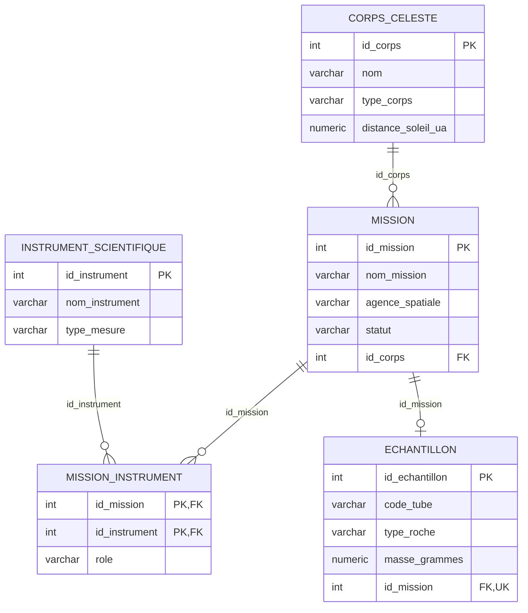

# 📊 Schéma Relationnel : `exploration_spatiale`

> **Version simplifiée et concise (3NF)**  
> **Source :** Base PostgreSQL 'exploration_spatiale' [5 tables]  
> 💡 **Aperçu visuel :** Dans VS Code, appuyez sur **`Ctrl + Shift + V`** (ou `Cmd + Shift + V`) pour afficher les graphiques.

---

## 🔑 Légende & Notations Générales

| Symbole / Badge | Signification | Description |
| :--- | :--- | :--- |
| `PK` | **Primary Key** | Clé primaire identifiant chaque enregistrement de manière unique. |
| `FK` | **Foreign Key** | Clé étrangère référençant la clé primaire d'une autre table. |
| `UK` | **Unique Key** | Contrainte d'unicité (colonne UNIQUE). |
| `PK, FK` | **Composite / Liaison** | Attribut à la fois clé primaire et clé étrangère (table d'association). |
| `FK, UK` | **Clé étrangère 1:1** | Clé étrangère avec contrainte UNIQUE garantissant une relation 1:1. |
| `\|\|--o{` | **Relation 1:N** | Un enregistrement parent peut être lié à 0 ou plusieurs enfants (*Un-à-Plusieurs*). |
| `\|\|--o\|` | **Relation 1:1** | Une mission est liée à 0 ou 1 échantillon maximum (*Un-à-Un optionnel*). |

---

## 🗺️ Schéma : `public` (5 tables épurées)

---

### 📋 Relations et Cardinalités

| Table Parente | Cardinalité | Table Enfant (FK) | Colonne FK | Contrainte clé |
| :--- | :---: | :--- | :--- | :--- |
| `corps_celeste` | `1:N` | `mission` | `id_corps` | Standard (1 cible a N missions) |
| `mission` | `1:1` | `echantillon` | `id_mission` | **`UNIQUE` (`UK`)** : 1 mission a au plus 1 échantillon |
| `mission` | `N:M` | `instrument_scientifique` | `id_mission, id_instrument` | Table de liaison `mission_instrument` |

---

### 📚 Dictionnaire des Données Épuré

#### Table `corps_celeste`
| Colonne | Type | Contrainte | Description |
| :--- | :--- | :---: | :--- |
| `id_corps` | `SERIAL` | `PK` | Identifiant unique de l'astre |
| `nom` | `VARCHAR(50)` | `NOT NULL, UNIQUE` | Nom de l'astre (Mars, Lune, etc.) |
| `type_corps` | `VARCHAR(40)` | `NOT NULL` | Catégorie (Planète tellurique, Lune glacée...) |
| `distance_soleil_ua` | `NUMERIC(5,2)` | `CHECK > 0` | Distance moyenne au Soleil en UA |

#### Table `mission`
| Colonne | Type | Contrainte | Description |
| :--- | :--- | :---: | :--- |
| `id_mission` | `SERIAL` | `PK` | Identifiant unique de la mission |
| `nom_mission` | `VARCHAR(60)` | `NOT NULL, UNIQUE` | Nom officiel (Mars 2020, Curiosity...) |
| `agence_spatiale` | `VARCHAR(40)` | `NOT NULL` | Agence opératrice (NASA, ESA...) |
| `statut` | `VARCHAR(30)` | `NOT NULL` | Statut opérationnel |
| `id_corps` | `INTEGER` | `FK` | Référence vers `corps_celeste` |

#### Table `instrument_scientifique`
| Colonne | Type | Contrainte | Description |
| :--- | :--- | :---: | :--- |
| `id_instrument` | `SERIAL` | `PK` | Identifiant unique de l'instrument |
| `nom_instrument` | `VARCHAR(50)` | `NOT NULL, UNIQUE` | Nom de l'équipement (SuperCam, Mastcam-Z...) |
| `type_mesure` | `VARCHAR(50)` | `NOT NULL` | Technique scientifique employée |

#### Table `mission_instrument` (Association N:M)
| Colonne | Type | Contrainte | Description |
| :--- | :--- | :---: | :--- |
| `id_mission` | `INTEGER` | `PK, FK` | Référence vers `mission` |
| `id_instrument` | `INTEGER` | `PK, FK` | Référence vers `instrument_scientifique` |
| `role` | `VARCHAR(50)` | `NOT NULL` | Rôle de l'instrument sur la mission |

#### Table `echantillon` (Relation 1:1)
| Colonne | Type | Contrainte | Description |
| :--- | :--- | :---: | :--- |
| `id_echantillon` | `SERIAL` | `PK` | Identifiant de l'échantillon |
| `code_tube` | `VARCHAR(30)` | `NOT NULL, UNIQUE` | Code du tube scellé |
| `type_roche` | `VARCHAR(50)` | `NOT NULL` | Nature géologique de la roche |
| `masse_grammes` | `NUMERIC(6,2)` | `CHECK > 0` | Masse prélevée en grammes |
| `id_mission` | `INTEGER` | `FK, UK` | **Relation 1:1** vers `mission` (Clé étrangère UNIQUE) |
