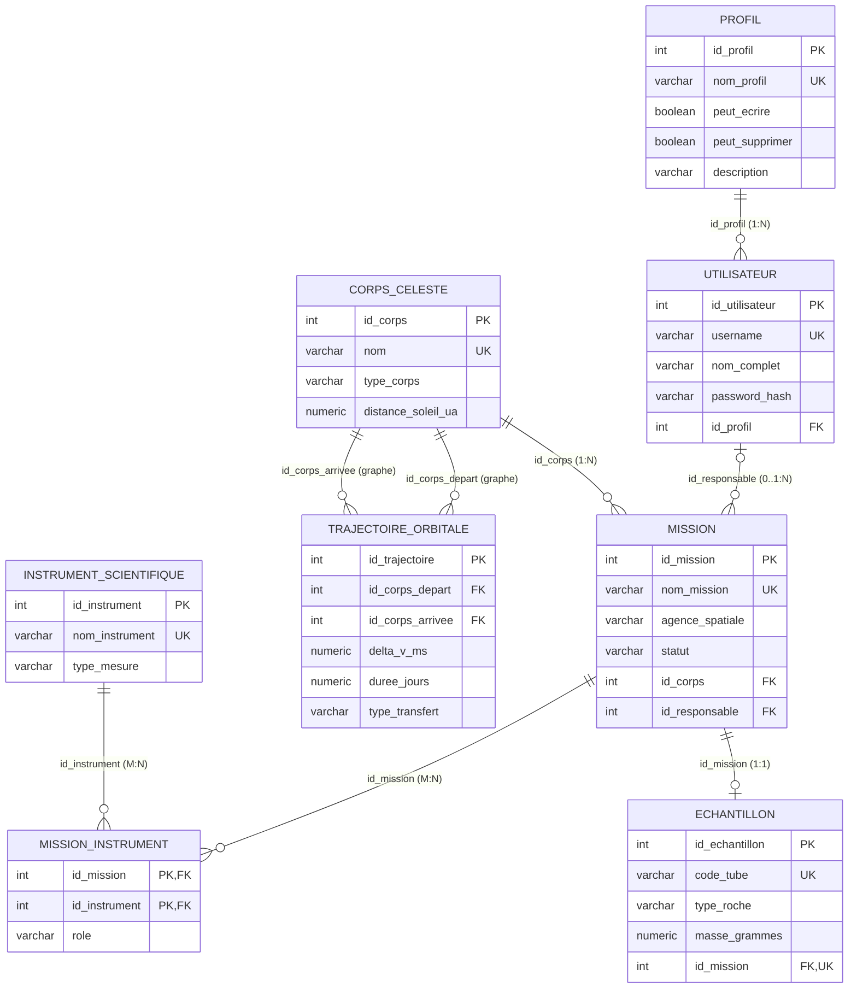
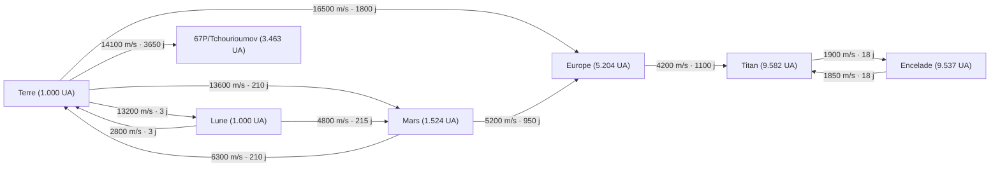

# 📊 Schéma Relationnel & Graphe Orbital : `exploration_spatiale`

> **Modèle 3NF complet — 8 tables** (dont 2 associations `M:N`, 3 relations `1:N`, 1 relation `1:1`, profils utilisateurs MD5 et graphe orienté pondéré à double sens).  
> **Source SQL :** [`sql/01_schema.sql`](sql/01_schema.sql)  
> 💡 **Aperçu visuel dans VS Code / Antigravity :** appuyez sur **`Ctrl + Shift + V`** pour afficher les diagrammes Mermaid.

---

## 🔑 1. Légende des notations

| Symbole | Signification | Rôle |
| :--- | :--- | :--- |
| `PK` | **Primary Key** | Clé primaire identifiant chaque ligne de manière unique. |
| `FK` | **Foreign Key** | Clé étrangère référençant la clé primaire d'une table parente. |
| `UK` | **Unique Key** | Contrainte d'unicité (`UNIQUE`). |
| `PK, FK` | **Clé composite de liaison** | Attribut à la fois clé primaire composite et clé étrangère (`mission_instrument`). |
| `FK, UK` | **Relation `1:1` ou unicité orientée** | Garantit au plus 1 échantillon par mission (`echantillon.id_mission`). |
| `\|\|--o{` | **Cardinalité `1:N`** | Un parent est lié à `0` ou plusieurs enfants. |
| `\|o--o{` | **Cardinalité `0..1 : N`** | Un responsable optionnel peut superviser `0` ou plusieurs missions. |
| `\|\|--o\|` | **Cardinalité `1:1` optionnelle** | Une mission dispose de `0` ou `1` échantillon maximum. |

---

## 🗺️ 2. Diagramme Entité-Association (ERD — 8 tables)

---

## 🛰️ 3. Graphe orienté et pondéré (`trajectoire_orbitale`)

Chaque sommet est un enregistrement de `corps_celeste` et chaque flèche orientée est une ligne de `trajectoire_orbitale` pondérée par **`delta_v_ms` (énergie)** et **`duree_jours` (temps)**.  
Les liaisons **double sens** (`Terre <-> Lune`, `Terre <-> Mars`, `Titan <-> Encelade`) sont stockées comme **deux arcs orientés distincts** avec des coûts asymétriques (le retour vers la Terre coûte beaucoup moins en Δv grâce à l'aérofreinage).

> 💡 **Exemple concret d'optimisation (Dijkstra dans [`app.py`](app.py)) :**
> Pour aller de **Terre** vers **Europe** :
> * Chemin minimal en **énergie (`delta_v_ms`)** : `Terre -> Europe` (`16 500 m/s`, `1 800 j`).
> * Chemin minimal en **durée (`duree_jours`)** : `Terre -> Mars -> Europe` (`1 160 j`, `18 800 m/s`).

---

## 📋 4. Tableau récapitulatif des relations et cardinalités

| Table parente | Cardinalité | Table enfant / liaison | Clé étrangère | Règle métier & contrainte |
| :--- | :---: | :--- | :--- | :--- |
| `profil` | `1:N` | `utilisateur` | `id_profil` | Un profil définit les droits partagés par plusieurs comptes (`ON DELETE RESTRICT`). |
| `utilisateur` | `0..1 : N` | `mission` | `id_responsable` | Un utilisateur peut superviser plusieurs missions ; `NULL` permis pour imports externes (`ON DELETE SET NULL`). |
| `corps_celeste` | `1:N` | `mission` | `id_corps` | Un corps céleste peut être ciblé par plusieurs missions (`ON DELETE RESTRICT`). |
| `mission` | `M:N` | `instrument_scientifique` | `mission_instrument (id_mission, id_instrument)` | Une mission embarque plusieurs instruments et un instrument équipe plusieurs missions. |
| `corps_celeste` | `M:N` réflexive | `trajectoire_orbitale` | `id_corps_depart`, `id_corps_arrivee` | Graphe orienté pondéré ; `UNIQUE (id_corps_depart, id_corps_arrivee)` + `CHECK (depart <> arrivee)` autorise le double sens sans doublon ni boucle. |
| `mission` | `1:1` | `echantillon` | `id_mission` (`UNIQUE`) | Une mission dispose au maximum d'un échantillon géologique (`ON DELETE CASCADE`). |

---

## 📚 5. Dictionnaire complet des données (8 tables)

### Table 1 : `profil`
| Colonne | Type | Contraintes | Description |
| :--- | :--- | :--- | :--- |
| `id_profil` | `SERIAL` | `PK` | Identifiant unique du profil |
| `nom_profil` | `VARCHAR(40)` | `NOT NULL, UNIQUE` | Nom du rôle (`administrateur`, `scientifique`, `observateur`) |
| `peut_ecrire` | `BOOLEAN` | `NOT NULL, DEFAULT FALSE` | Autorise les opérations `INSERT` et `UPDATE` |
| `peut_supprimer` | `BOOLEAN` | `NOT NULL, DEFAULT FALSE` | Autorise les opérations `DELETE` et gestion de comptes |
| `description` | `VARCHAR(150)` | `NOT NULL` | Résumé des permissions du profil |

### Table 2 : `utilisateur`
| Colonne | Type | Contraintes | Description |
| :--- | :--- | :--- | :--- |
| `id_utilisateur` | `SERIAL` | `PK` | Identifiant unique du compte |
| `username` | `VARCHAR(60)` | `NOT NULL, UNIQUE` | Identifiant de connexion |
| `nom_complet` | `VARCHAR(100)` | `NOT NULL` | Prénom et nom de l'utilisateur |
| `password_hash` | `VARCHAR(64)` | `NOT NULL` | Empreinte hachée (`md5(...)`), jamais stockée en clair |
| `id_profil` | `INTEGER` | `NOT NULL, FK -> profil` | Rôle attribué (`ON DELETE RESTRICT`) |

### Table 3 : `corps_celeste`
| Colonne | Type | Contraintes | Description |
| :--- | :--- | :--- | :--- |
| `id_corps` | `SERIAL` | `PK` | Identifiant unique de l'astre (sommet du graphe) |
| `nom` | `VARCHAR(100)` | `NOT NULL, UNIQUE` | Nom de l'astre (`Terre`, `Mars`, `Lune`, `Encelade`...) |
| `type_corps` | `VARCHAR(60)` | `NOT NULL` | Catégorie (`Planète tellurique`, `Lune glacée`, `Comète`...) |
| `distance_soleil_ua` | `NUMERIC(10,3)` | `CHECK (> 0)` | Distance moyenne au Soleil en UA (nullable pour imports externes) |

### Table 4 : `trajectoire_orbitale` (Graphe orienté pondéré)
| Colonne | Type | Contraintes | Description |
| :--- | :--- | :--- | :--- |
| `id_trajectoire` | `SERIAL` | `PK` | Identifiant unique de l'arête orientée |
| `id_corps_depart` | `INTEGER` | `NOT NULL, FK -> corps_celeste` | Astre d'origine (`ON DELETE CASCADE`) |
| `id_corps_arrivee` | `INTEGER` | `NOT NULL, FK -> corps_celeste` | Astre de destination (`ON DELETE CASCADE`, `<> id_corps_depart`) |
| `delta_v_ms` | `NUMERIC(9,2)` | `NOT NULL, CHECK (> 0)` | Poids énergétique en m/s |
| `duree_jours` | `NUMERIC(7,1)` | `NOT NULL, CHECK (> 0)` | Poids temporel en jours |
| `type_transfert` | `VARCHAR(80)` | `NOT NULL` | Mécanique orbitale (`Transfert de Hohmann`, `Aérofreinage`...) |
| *(Contrainte table)* | `UNIQUE` | `(id_corps_depart, id_corps_arrivee)` | Autorise le double sens (`A->B` et `B->A`) sans arête dupliquée |

### Table 5 : `mission`
| Colonne | Type | Contraintes | Description |
| :--- | :--- | :--- | :--- |
| `id_mission` | `SERIAL` | `PK` | Identifiant unique de la mission |
| `nom_mission` | `VARCHAR(100)` | `NOT NULL, UNIQUE` | Nom officiel (`Mars 2020 (Perseverance)`, `JUICE`...) |
| `agence_spatiale` | `VARCHAR(80)` | `NOT NULL` | Agence opératrice (`NASA`, `ESA`, `NASA / ESA`...) |
| `statut` | `VARCHAR(40)` | `NOT NULL` | Statut (`Opérationnelle`, `En transit`, `En préparation`, `Terminée`) |
| `id_corps` | `INTEGER` | `NOT NULL, FK -> corps_celeste` | Astre ciblé (`ON DELETE RESTRICT`) |
| `id_responsable` | `INTEGER` | `NULL, FK -> utilisateur` | Responsable scientifique optionnel (`ON DELETE SET NULL`) |

### Table 6 : `instrument_scientifique`
| Colonne | Type | Contraintes | Description |
| :--- | :--- | :--- | :--- |
| `id_instrument` | `SERIAL` | `PK` | Identifiant unique de l'instrument |
| `nom_instrument` | `VARCHAR(100)` | `NOT NULL, UNIQUE` | Nom de l'équipement (`SuperCam`, `Mastcam-Z`, `PIXL`...) |
| `type_mesure` | `VARCHAR(100)` | `NOT NULL` | Technique de mesure employée |

### Table 7 : `mission_instrument` (Association `M:N`)
| Colonne | Type | Contraintes | Description |
| :--- | :--- | :--- | :--- |
| `id_mission` | `INTEGER` | `PK, FK -> mission` | Référence vers la mission (`ON DELETE CASCADE`) |
| `id_instrument` | `INTEGER` | `PK, FK -> instrument_scientifique` | Référence vers l'instrument (`ON DELETE RESTRICT`) |
| `role` | `VARCHAR(100)` | `NOT NULL` | Rôle précis de l'instrument sur cette mission |

### Table 8 : `echantillon` (Relation `1:1`)
| Colonne | Type | Contraintes | Description |
| :--- | :--- | :--- | :--- |
| `id_echantillon` | `SERIAL` | `PK` | Identifiant unique de l'échantillon |
| `code_tube` | `VARCHAR(40)` | `NOT NULL, UNIQUE` | Code du tube scellé (`PER-01-ROU`, `ART-01-REG`...) |
| `type_roche` | `VARCHAR(100)` | `NOT NULL` | Nature géologique de la roche |
| `masse_grammes` | `NUMERIC(10,2)` | `NOT NULL, CHECK (> 0)` | Masse prélevée en grammes |
| `id_mission` | `INTEGER` | `NOT NULL, FK, UK -> mission` | Clé étrangère `UNIQUE` garantissant la relation `1:1` (`ON DELETE CASCADE`) |
