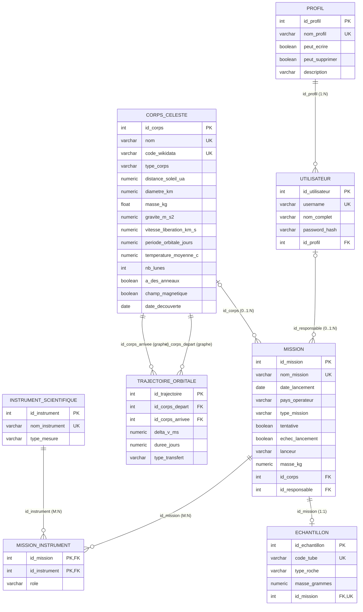
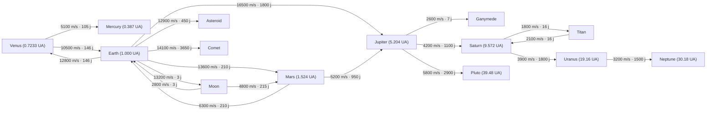

# 📊 Schéma Relationnel & Graphe Orbital : `exploration_spatiale`

> **Modèle 3NF complet — 8 tables** alimenté directement par les 2 bases CSV réelles (`data/aidb-solar-system-planets.csv` et `data/aidb-lunar-and-planetary-missions.csv` : **15 corps célestes** et **279 missions** de 1957 à 2025).  
> **Source SQL :** [`sql/01_schema.sql`](sql/01_schema.sql)  
> 💡 **Aperçu visuel dans VS Code / Antigravity :** appuyez sur **`Ctrl + Shift + V`** pour afficher les diagrammes Mermaid.

---

## 🔑 1. Légende des notations

| Symbole | Signification | Rôle |
| :--- | :--- | :--- |
| `PK` | **Primary Key** | Clé primaire identifiant chaque ligne de manière unique. |
| `FK` | **Foreign Key** | Clé étrangère référençant la clé primaire d'une table parente. |
| `UK` | **Unique Key** | Contrainte d'unicité (`UNIQUE`). |
| `PK, FK` | **Clé composite de liaison** | Attribut à la fois clé primaire composite et clé étrangère (`mission_instrument`). |
| `FK, UK` | **Relation `1:1`** | Garantit au plus 1 échantillon par mission (`echantillon.id_mission`). |
| `\|\|--o{` | **Cardinalité `1:N`** | Un parent est lié à `0` ou plusieurs enfants. |
| `\|o--o{` | **Cardinalité `0..1 : N`** | Clé étrangère nullable (ex. missions sans cible planétaire ou sans responsable assigné). |
| `\|\|--o\|` | **Cardinalité `1:1` optionnelle** | Une mission dispose de `0` ou `1` échantillon maximum. |

---

## 🗺️ 2. Diagramme Entité-Association (ERD — 8 tables)

---

## 🛰️ 3. Graphe orienté et pondéré (`trajectoire_orbitale`)

Tous les sommets proviennent strictement des **15 corps célestes issus des 2 CSV**. Chaque flèche est une arête orientée pondérée par **`delta_v_ms`** et **`duree_jours`**. Quatre paires disposent d'un **double sens asymétrique** (`Earth <-> Moon`, `Earth <-> Mars`, `Earth <-> Venus`, `Saturn <-> Titan`).

> 💡 **Exemple concret Dijkstra dans [`app.py`](app.py) :**
> Pour aller de **Earth** vers **Jupiter** :
> * Chemin minimal en **énergie (`delta_v_ms`)** : `Earth -> Jupiter` (`16 500 m/s`, `1 800 j`).
> * Chemin minimal en **durée (`duree_jours`)** : `Earth -> Mars -> Jupiter` (`1 160 j`, `18 800 m/s`).

---

## 📋 4. Tableau récapitulatif des relations et cardinalités

| Table parente | Cardinalité | Table enfant / liaison | Clé étrangère & `ON DELETE` | Règle métier |
| :--- | :---: | :--- | :--- | :--- |
| `profil` | `1:N` | `utilisateur` | `id_profil` (`RESTRICT`) | Un profil définit les droits partagés par plusieurs comptes. |
| `utilisateur` | `0..1 : N` | `mission` | `id_responsable` (`SET NULL`) | Un responsable supervise plusieurs missions ; `NULL` permis pour les missions historiques. |
| `corps_celeste` | `0..1 : N` | `mission` | `id_corps` (`RESTRICT`) | Un astre cible plusieurs missions ; `NULL` permis pour les 3 missions du CSV sans cible (`Zond 4`, `Kepler`, `Q-PACE`). |
| `mission` | `M:N` | `instrument_scientifique` | `mission_instrument` (`CASCADE` / `RESTRICT`) | Une mission embarque plusieurs instruments et un instrument équipe plusieurs missions (`Magnétomètre`). |
| `corps_celeste` | `M:N` réflexive | `trajectoire_orbitale` | `id_corps_depart`, `id_corps_arrivee` (`CASCADE`) | Graphe orienté pondéré ; `UNIQUE (depart, arrivee)` + `CHECK (depart <> arrivee)` autorise le double sens. |
| `mission` | `1:1` | `echantillon` | `id_mission` `UNIQUE` (`CASCADE`) | Une mission dispose au maximum d'un échantillon géologique. |

---

## 📚 5. Dictionnaire complet des données (8 tables)

### Table 1 : `profil`
| Colonne | Type | Contraintes | Description |
| :--- | :--- | :--- | :--- |
| `id_profil` | `SERIAL` | `PK` | Identifiant unique du profil |
| `nom_profil` | `VARCHAR(40)` | `NOT NULL, UNIQUE` | Nom du rôle (`administrateur`, `scientifique`, `observateur`) |
| `peut_ecrire` | `BOOLEAN` | `NOT NULL, DEFAULT FALSE` | Autorise les opérations `INSERT` et `UPDATE` |
| `peut_supprimer` | `BOOLEAN` | `NOT NULL, DEFAULT FALSE` | Autorise les opérations `DELETE` et gestion de comptes |
| `description` | `VARCHAR(150)` | `NOT NULL` | Résumé des permissions du profil |

### Table 2 : `utilisateur`
| Colonne | Type | Contraintes | Description |
| :--- | :--- | :--- | :--- |
| `id_utilisateur` | `SERIAL` | `PK` | Identifiant unique du compte |
| `username` | `VARCHAR(60)` | `NOT NULL, UNIQUE` | Identifiant de connexion |
| `nom_complet` | `VARCHAR(100)` | `NOT NULL` | Nom complet de l'utilisateur |
| `password_hash` | `VARCHAR(64)` | `NOT NULL` | Empreinte hachée (`md5(...)`), jamais stockée en clair |
| `id_profil` | `INTEGER` | `NOT NULL, FK -> profil` | Rôle attribué (`ON DELETE RESTRICT`) |

### Table 3 : `corps_celeste` (15 enregistrements 100 % issus des 2 CSV)
| Colonne | Type | Contraintes | Description |
| :--- | :--- | :--- | :--- |
| `id_corps` | `SERIAL` | `PK` | Identifiant unique de l'astre (sommet du graphe) |
| `nom` | `VARCHAR(100)` | `NOT NULL, UNIQUE` | Nom issu des CSV (`Earth`, `Mars`, `Moon`, `Jupiter`, `Uranus`...) |
| `code_wikidata` | `VARCHAR(20)` | `UNIQUE` | Identifiant Wikidata (`Q2`, `Q111`...) issu de `planets.csv` |
| `type_corps` | `VARCHAR(60)` | `NOT NULL` | Classe (`Planet`, `Dwarf planet`, `Moon`, `Star`, `Small body`) |
| `distance_soleil_ua` | `NUMERIC(10,4)` | `CHECK (> 0)` | Demi-grand axe en UA (`semi_major_axis_au`, nullable hors planètes) |
| `diametre_km` | `NUMERIC(10,2)` | `CHECK (> 0)` | Diamètre en km (`diameter_km`) |
| `masse_kg` | `DOUBLE PRECISION` | `CHECK (> 0)` | Masse en kg en notation scientifique (`mass_kg`) |
| `gravite_m_s2` | `NUMERIC(6,2)` | `CHECK (> 0)` | Gravité de surface en m/s² (`gravity_m_s2`) |
| `vitesse_liberation_km_s` | `NUMERIC(6,2)` | `CHECK (> 0)` | Vitesse de libération en km/s (`escape_velocity_km_s`) |
| `periode_orbitale_jours` | `NUMERIC(10,2)` | `CHECK (> 0)` | Période orbitale en jours (`orbital_period_days`) |
| `temperature_moyenne_c` | `NUMERIC(6,1)` | — | Température moyenne de surface en °C (`mean_temperature_c`) |
| `nb_lunes` | `INTEGER` | `CHECK (>= 0)` | Nombre de satellites naturels (`moons`) |
| `a_des_anneaux` | `BOOLEAN` | — | Présence d'anneaux planétaires (`has_rings`) |
| `champ_magnetique` | `BOOLEAN` | — | Présence d'un champ magnétique global (`global_magnetic_field`) |
| `date_decouverte` | `DATE` | — | Date de découverte pour Uranus, Neptune, Pluton (`discovery_date`) |

### Table 4 : `trajectoire_orbitale` (Graphe orienté pondéré — 19 arêtes)
| Colonne | Type | Contraintes | Description |
| :--- | :--- | :--- | :--- |
| `id_trajectoire` | `SERIAL` | `PK` | Identifiant unique de l'arête orientée |
| `id_corps_depart` | `INTEGER` | `NOT NULL, FK -> corps_celeste` | Astre d'origine (`ON DELETE CASCADE`) |
| `id_corps_arrivee` | `INTEGER` | `NOT NULL, FK -> corps_celeste` | Astre de destination (`ON DELETE CASCADE`, `<> id_corps_depart`) |
| `delta_v_ms` | `NUMERIC(9,2)` | `NOT NULL, CHECK (> 0)` | Poids énergétique en m/s |
| `duree_jours` | `NUMERIC(7,1)` | `NOT NULL, CHECK (> 0)` | Poids temporel en jours |
| `type_transfert` | `VARCHAR(80)` | `NOT NULL` | Mécanique orbitale (`Transfert de Hohmann`, `Aérofreinage`...) |
| *(Contrainte table)* | `UNIQUE` | `(id_corps_depart, id_corps_arrivee)` | Autorise le double sens (`A->B` et `B->A`) sans doublon |

### Table 5 : `mission` (279 missions réelles 100 % issues du CSV)
| Colonne | Type | Contraintes | Description |
| :--- | :--- | :--- | :--- |
| `id_mission` | `SERIAL` | `PK` | Identifiant unique de la mission |
| `nom_mission` | `VARCHAR(100)` | `NOT NULL, UNIQUE` | Nom officiel (`mission` du CSV) |
| `date_lancement` | `DATE` | — | Date de lancement (`launch_date`, 1957–2025) |
| `pays_operateur` | `VARCHAR(80)` | `NOT NULL` | Pays ou agence (`country` du CSV) |
| `type_mission` | `VARCHAR(120)` | `NOT NULL` | Type détaillé (`mission_type` du CSV) |
| `tentative` | `BOOLEAN` | `NOT NULL, DEFAULT FALSE` | Mission classée « tentative » (`attempted`) |
| `echec_lancement` | `BOOLEAN` | `NOT NULL, DEFAULT FALSE` | Échec au lancement (`launch_failure`) |
| `lanceur` | `VARCHAR(60)` | — | Fusée porteuse (`launch_vehicle`, nullable) |
| `masse_kg` | `NUMERIC(10,2)` | `CHECK (> 0)` | Masse au lancement en kg (`mass_kg`, nullable) |
| `id_corps` | `INTEGER` | `NULL, FK -> corps_celeste` | Cible (`ON DELETE RESTRICT`, `NULL` pour `Zond 4`, `Kepler`, `Q-PACE`) |
| `id_responsable` | `INTEGER` | `NULL, FK -> utilisateur` | Responsable applicatif optionnel (`ON DELETE SET NULL`) |

### Table 6 : `instrument_scientifique`
| Colonne | Type | Contraintes | Description |
| :--- | :--- | :--- | :--- |
| `id_instrument` | `SERIAL` | `PK` | Identifiant unique de l'instrument |
| `nom_instrument` | `VARCHAR(100)` | `NOT NULL, UNIQUE` | Nom de l'équipement (`SuperCam`, `Mastcam-Z`, `Magnétomètre`...) |
| `type_mesure` | `VARCHAR(100)` | `NOT NULL` | Technique scientifique employée |

### Table 7 : `mission_instrument` (Association `M:N`)
| Colonne | Type | Contraintes | Description |
| :--- | :--- | :--- | :--- |
| `id_mission` | `INTEGER` | `PK, FK -> mission` | Référence vers une mission du CSV (`ON DELETE CASCADE`) |
| `id_instrument` | `INTEGER` | `PK, FK -> instrument_scientifique` | Référence vers l'instrument (`ON DELETE RESTRICT`) |
| `role` | `VARCHAR(100)` | `NOT NULL` | Rôle précis de l'instrument sur cette mission |

### Table 8 : `echantillon` (Relation `1:1`)
| Colonne | Type | Contraintes | Description |
| :--- | :--- | :--- | :--- |
| `id_echantillon` | `SERIAL` | `PK` | Identifiant unique de l'échantillon |
| `code_tube` | `VARCHAR(40)` | `NOT NULL, UNIQUE` | Code unique du tube scellé (`PER-01-ROU`, `APO-11-MAR`...) |
| `type_roche` | `VARCHAR(100)` | `NOT NULL` | Nature géologique de la roche |
| `masse_grammes` | `NUMERIC(10,2)` | `NOT NULL, CHECK (> 0)` | Masse prélevée en grammes |
| `id_mission` | `INTEGER` | `NOT NULL, FK, UK -> mission` | Clé étrangère `UNIQUE` garantissant la relation `1:1` (`ON DELETE CASCADE`) |
