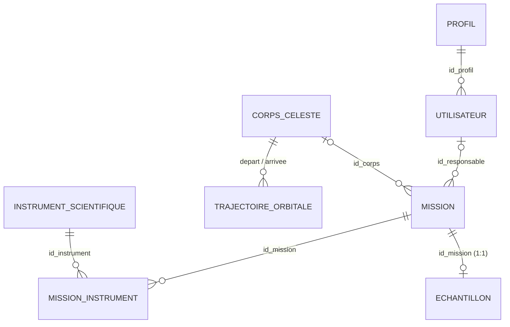

# Projet BDD & Python : Exploration Spatiale & Planétologie (3NF — 8 tables)

Modélisation relationnelle complète en **3e Forme Normale (3NF)** d'un système d'information d'exploration spatiale alimenté par **deux vraies bases de données CSV** (**15 corps célestes** et **279 missions spatiales réelles** de 1957 à 2025), avec gestion des profils par mots de passe hachés (`md5`), **graphe orienté et pondéré à double sens** (`trajectoire_orbitale`) et application CLI complète en Python.

---

## ✅ Conformité aux consignes du projet

| Exigence | Implémentation dans le projet |
| :--- | :--- |
| **Au moins 7 tables (associations incluses)** | **8 tables** en 3NF (aucune table superflue ajoutée pour les 2 CSV) : `profil`, `utilisateur`, `corps_celeste`, `trajectoire_orbitale`, `mission`, `instrument_scientifique`, `mission_instrument`, `echantillon`. |
| **Intégration des 2 CSV réels (`data/`)** | **100 % des 9 planètes** de `aidb-solar-system-planets.csv` + **6 cibles complémentaires** et **279 missions réelles** de `aidb-lunar-and-planetary-missions.csv` (zéro corps céleste ni mission inventé). |
| **Relations `1:N`, `M:N` et `1:1`** | `profil -> utilisateur`, `corps_celeste -> mission`, `utilisateur -> mission` (`1:N` / `0..1:N`) ; `mission_instrument` et `trajectoire_orbitale` (`M:N`) ; `mission <-> echantillon` (`1:1`). |
| **Profils & mots de passe hachés (`md5`)** | Tables `profil` + `utilisateur`, mots de passe jamais stockés en clair (`md5(...)`), contrôle strict des droits (`observateur`, `scientifique`, `administrateur`). |
| **Graphe orienté pondéré (double sens)** | Table `trajectoire_orbitale` (19 arêtes orientées dont 4 paires double sens asymétriques, poids `delta_v_ms` + `duree_jours`) et algorithme **Dijkstra** dans [`app.py`](app.py). |
| **Programme Python CLI (CRUD + 3 états)** | [`app.py`](app.py) : authentification, recherche sur les 279 missions, 2+ insertions, modification avant/après, suppression vérifiée (`COUNT(*) = 0`) et 3 états SQL multi-tables. |

---

## 📚 Sommaire de la documentation du projet

| Document | Contenu |
| :--- | :--- |
| [`DIAGRAMME.md`](DIAGRAMME.md) | Diagramme **ERD complet (8 tables)**, **graphe orbital Mermaid**, tableau des cardinalités et dictionnaire des données. |
| [`docs/architecture-et-modele.md`](docs/architecture-et-modele.md) | Architecture complète : intégration des 2 CSV sans sur-extension, justifications 3NF, **clauses `ON DELETE`**, mots-clés PostgreSQL, graphe pondéré et sécurité `md5()`. |
| [`docs/guide-oral-et-demo.md`](docs/guide-oral-et-demo.md) | Feuille de route prête pour les deux soutenances (**30 novembre** : modèle ERD ; **7 décembre** : scénario live complet sur `app.py`). |
| [`docs/role-script-python.md`](docs/role-script-python.md) | Explication pédagogique simple du rôle de Python face au SQL et décryptage des syntaxes Python/PostgreSQL. |
| [`docs/environnement-python.md`](docs/environnement-python.md) | Fonctionnement hybride `uv` + `venv`/`pip` pour le travail en binôme. |
| [`docs/historique.md`](docs/historique.md) | Historique compact de l'évolution du projet. |

---

## 🗺️ Vue synthétique du schéma relationnel (8 tables)



> 👉 Voir le schéma complet avec tous les attributs, clés et le graphe orbital dans [`DIAGRAMME.md`](DIAGRAMME.md).

---

## 📁 Organisation des fichiers

```text
devoirBDD/
├── README.md                                    # Porte d'entrée, sommaire et démarrage rapide
├── DIAGRAMME.md                                 # ERD 8 tables, graphe orbital et dictionnaire
├── db.py                                        # Connexion PostgreSQL typée (.env) et UTF-8 Windows
├── app.py                                       # Application CLI (auth MD5, CRUD, 3 états, Dijkstra)
├── insertion_echantillon.py                     # Démo autonome UPSERT 1:1 (mission Chang'e 5)
├── import_csv.py                                # Chargeur officiel des 2 CSV + générateur 02_seed.sql
├── data/
│   ├── aidb-solar-system-planets.csv            # Dataset réel : 9 planètes et propriétés physiques
│   └── aidb-lunar-and-planetary-missions.csv    # Dataset réel : 279 missions spatiales (1957-2025)
├── sql/
│   ├── 01_schema.sql                            # Création des 8 tables 3NF et contraintes
│   ├── 02_seed.sql                              # Jeu de données généré depuis les 2 CSV + tables métiers
│   └── 03_queries.sql                           # 3 états multi-tables + graphe + MD5 + bilan par pays
├── docs/
│   ├── architecture-et-modele.md                # Architecture, 3NF, ON DELETE, CSV et sécurité
│   ├── guide-oral-et-demo.md                    # Guide oral (30 nov.) et démo live (7 déc.)
│   ├── role-script-python.md                    # Guide pédagogique Python / SQL
│   ├── environnement-python.md                  # Guide collaboratif uv + venv/pip
│   ├── historique.md                            # Historique compact
│   └── plan.md                                  # Plan temps réel de la session courante
├── pyproject.toml / uv.lock / requirements.txt  # Dépendances Python synchronisées (uv + venv)
└── .env.example                                 # Modèle des variables d'environnement PostgreSQL
```

---

## 📊 Les 3 états SQL (plus 3 requêtes bonus)

Dans [`sql/03_queries.sql`](sql/03_queries.sql) et dans [`app.py`](app.py) :

1. **État 1 (`INNER JOIN` sur 5 tables) :** Missions suivies sans échec au lancement, cible planétaire, responsable scientifique et instruments embarqués (`Mars 2020`, `Mars Science Laboratory`, `Cassini`, `Rosetta`, `JUICE`, `Voyager 1`).
2. **État 2 (`LEFT JOIN` + `GROUP BY`) :** Couverture des **15 corps célestes** par les 279 missions (nombre de tirs, échecs, date du dernier lancement) — met en évidence **`Uranus`** et **`Neptune`** (`0` mission cible dédiée).
3. **État 3 (`GROUP BY` + `HAVING`) :** Bilan géologique par corps céleste exploré (nombre d'échantillons `1:1`, masse totale et masse moyenne sur `Moon`, `Asteroid`, `Mars`, `Comet`).
4. **Requête 4 (Graphe) :** Réseau des 19 trajectoires orientées pondérées avec détection `Double sens` / `Sens unique`.
5. **Requête 5 (Sécurité MD5) :** Vérification `WHERE username = 'tlenfant' AND password_hash = md5('password')` avec jointure sur `profil`.
6. **Requête 6 (Analytique CSV) :** Classement des pays/agences par nombre de missions et taux de succès au lancement sur les 279 missions.

---

## 🚀 Mise en route (PostgreSQL + Python)

### 1. Prérequis

* **PostgreSQL** (version 14+ recommandée) installé et démarré localement.
* **Python 3.11+** (3.12 recommandé).

### 2. Configuration des identifiants (`.env`) — Pourquoi ne pas les mettre en dur dans Python ?

> [!IMPORTANT]
> **Note pour le travail en binôme sur GitHub :**
> Dans l'exemple initial du cours, les identifiants PostgreSQL étaient écrits en clair directement dans le script Python pour faire simple. Dès qu'on partage un projet via **Git / GitHub**, cette méthode pose deux problèmes :
>
> 1. **Sécurité sur GitHub :** Tout ce qui est écrit dans les fichiers `.py` est envoyé sur GitHub et conservé dans l'historique Git. On ne doit jamais publier un mot de passe (même local) dans le code source.
> 2. **Travail sur deux PC différents :** Le mot de passe PostgreSQL (voire le port ou l'utilisateur) n'est pas forcément le même sur ton PC et sur le mien. Si les identifiants étaient écrits en dur dans le script, chacun modifierait le fichier de l'autre à chaque `git pull` / `git push`.

| Fichier | Présent sur GitHub ? | Rôle |
| :--- | :---: | :--- |
| `.env.example` | ✅ Oui (partagé) | Modèle sans mot de passe réel montrant les variables attendues. |
| `.env` | ❌ Non (ignoré par `.gitignore`) | Contient **tes** vrais identifiants locaux, uniquement sur ta machine. |

```powershell
# PowerShell (Windows) — à faire une seule fois après git clone
Copy-Item .env.example .env
# Puis renseigner PGPASSWORD dans .env
```

### 3. Déploiement de la base PostgreSQL

```powershell
psql -h localhost -U postgres -c "CREATE DATABASE exploration_spatiale;"
psql -h localhost -U postgres -d exploration_spatiale -v ON_ERROR_STOP=1 -f ./sql/01_schema.sql
psql -h localhost -U postgres -d exploration_spatiale -v ON_ERROR_STOP=1 -f ./sql/02_seed.sql
psql -h localhost -U postgres -d exploration_spatiale -v ON_ERROR_STOP=1 -f ./sql/03_queries.sql
```

*(Si l'un des deux fichiers CSV dans `data/` est modifié plus tard, `uv run python import_csv.py` recharge directement les CSV dans PostgreSQL en mode idempotent, et `uv run python import_csv.py --generate-seed` régénère `sql/02_seed.sql`.)*

### 4. Environnement Python & lancement des programmes

#### Option A — Avec `uv` (recommandée)

```powershell
uv sync
uv run python app.py                        # Application CLI complète (CRUD, 3 états, Dijkstra, MD5)
uv run python insertion_echantillon.py      # Démo autonome UPSERT 1:1 (Chang'e 5)
uv run python import_csv.py --dry-run       # Vérification des 2 CSV sans modifier la base
uv run python import_csv.py                 # Import / synchronisation directe des 2 CSV en base
```

#### Option B — Avec `venv` + `pip` standard (sans `uv`)

```powershell
python -m venv .venv
.\.venv\Scripts\Activate.ps1
pip install -r requirements.txt
python app.py
```

### 5. Comptes applicatifs de démonstration (`02_seed.sql`)

| Identifiant (`username`) | Mot de passe (démo) | Profil | Permissions |
| :--- | :--- | :--- | :--- |
| `tlenfant` | `password` | `administrateur` | Lecture + Écriture + Suppression + Gestion comptes |
| `admin` | `admin123` | `administrateur` | Lecture + Écriture + Suppression + Gestion comptes |
| `s.curie` | `science123` | `scientifique` | Lecture + Écriture (suppression refusée) |
| `invite` | `invite123` | `observateur` | Lecture seule (états + graphe) |
