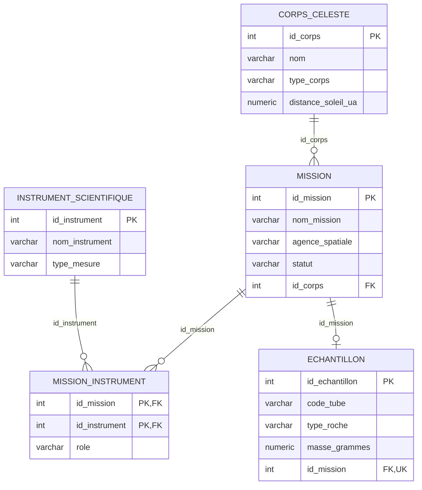

# Projet SQL : Exploration Spatiale & Planétologie (3NF Épuré)

Modélisation concise d'un système de gestion de données scientifiques pour l'exploration planétaire : corps célestes, missions d'exploration, instruments embarqués et prélèvement d'échantillons uniques.

---

## 🎯 Spécifications & Relations

1. **3ème Forme Normale (3NF)** :
   * Chaque table possède une clé primaire identifiante (`id_corps`, `id_mission`, `id_instrument`, `(id_mission, id_instrument)`, `id_echantillon`).
   * Tous les attributs dépendent directement et uniquement de la clé primaire (aucune dépendance transitive).
2. **Cardinalités implémentées** :
   * **Relation 1:N** : `corps_celeste` (1) ➔ `mission` (N) : Un corps céleste peut faire l'objet de plusieurs missions.
   * **Relation N:M** : `mission` (N) 🡘 `instrument_scientifique` (M) via la table de liaison `mission_instrument`.
   * **Relation 1:1** : `mission` (1) 🡘 `echantillon` (1) via une contrainte `id_mission INTEGER NOT NULL UNIQUE` dans la table `echantillon`. Une mission dispose au maximum d'un échantillon géologique associé.
3. **Schéma épuré et concis** : Les tables se concentrent sur l'essentiel (3 à 5 attributs ciblés par table, sans redondance).
4. **Pas d'index superflus** : Seuls les index implicites des clés primaires et contraintes `UNIQUE` sont utilisés.
5. **3 requêtes types** : Jointure fermée (`INNER JOIN`), jointure ouverte (`LEFT JOIN`), et agrégation (`GROUP BY` + `HAVING`).
6. **Script Python (`psycopg`)** : Insertion sécurisée paramétrée avec gestion de la relation 1:1 (`UPSERT`) et chargement des identifiants via `.env`.

---

## 🗺️ Schéma relationnel (Mermaid ERD)



---

## 📁 Organisation des fichiers

```text
devoirBDD/
├── README.md                    # Documentation du projet et guide de démarrage
├── DIAGRAMME.md                 # Schéma détaillé et dictionnaire des données
├── AGENTS.md                    # Directives locales pour Google Antigravity
├── .agents/                     # Règles et skills locaux (SQL, Python, test BDD)
├── docs/                        # Plan de suivi, guide Python et documentation environnement
├── insertion_echantillon.py     # Script Python psycopg (insertion 1:1 et consultation)
├── pyproject.toml               # Configuration projet Python & dépendances (uv / PEP 621)
├── uv.lock                      # Verrou d'intégrité des dépendances pour uv
├── requirements.txt             # Liste des dépendances exportée pour venv / pip
├── .python-version              # Version Python cible (3.12)
├── .env.example                 # Modèle des variables d'environnement PostgreSQL
└── sql/
    ├── 01_schema.sql            # Création des 5 tables épurées (1:1, 1:N, N:M)
    ├── 02_seed.sql              # Jeu de données cohérent
    └── 03_queries.sql           # Les 3 requêtes SQL clés
```

---

## 📊 Les 3 Requêtes SQL

1. **Jointure fermée (`INNER JOIN`) :** Liste des instruments déployés sur les missions actives et leur mission/cible respective.
2. **Jointure ouverte (`LEFT JOIN`) :** Inventaire exhaustif des corps célestes permettant d'identifier ceux qui n'ont aucune mission programmée (*Encelade*).
3. **Agrégation (`GROUP BY` + `HAVING`) :** Synthèse par corps céleste exploré calculant le nombre d'échantillons uniques collectés et la masse totale.

---

## 🚀 Mise en route (PostgreSQL + Python)

### 1. Prérequis

* **PostgreSQL** (version 14+ recommandée) installé et démarré localement.
* **Python 3.11+** (3.12 recommandé).

### 2. Configuration des identifiants (`.env`) — Pourquoi ne pas les mettre en dur dans Python ?

> [!IMPORTANT]
> **Note pour le travail en binôme sur GitHub :**
> Dans l'exemple initial du cours, les identifiants PostgreSQL étaient écrits en clair directement dans le script Python pour faire simple. Dès qu'on partage un projet via **Git / GitHub**, cette méthode pose deux problèmes :
>
> 1. **Sécurité sur GitHub :** Tout ce qui est écrit dans `insertion_echantillon.py` est envoyé sur GitHub et conservé dans l'historique Git. On ne doit jamais publier un mot de passe (même local) dans le code source.
> 2. **Travail sur deux PC différents :** Le mot de passe PostgreSQL (voire le port ou l'utilisateur) n'est pas forcément le même sur ton PC et sur le mien. Si les identifiants étaient écrits en dur dans le script, chacun modifierait le fichier de l'autre à chaque `git pull` / `git push`.

**Comment fonctionne la séparation `.env.example` / `.env` ?**

| Fichier | Présent sur GitHub ? | Rôle |
| :--- | :---: | :--- |
| `.env.example` | ✅ Oui (partagé) | Sert de **modèle** sans mot de passe réel pour montrer les variables attendues. |
| `.env` | ❌ Non (ignoré par `.gitignore`) | Contient **tes** vrais identifiants locaux. Il reste uniquement sur ta machine. |

**Étapes à suivre une seule fois après avoir cloné le dépôt :**

1. Créez votre fichier local `.env` à partir du modèle :

```powershell
# PowerShell (Windows)
Copy-Item .env.example .env
```

```bash
# Linux / macOS
cp .env.example .env
```

2. Ouvrez votre fichier `.env` et renseignez **votre** mot de passe PostgreSQL local dans `PGPASSWORD` (ainsi que le port/utilisateur s'ils diffèrent de `postgres@localhost:5432`).
3. Le script [`insertion_echantillon.py`](insertion_echantillon.py) lira automatiquement ce fichier `.env` au démarrage grâce à `python-dotenv` — sans jamais rien modifier dans le code partagé sur GitHub.

### 3. Déploiement de la base PostgreSQL

Créez la base `exploration_spatiale`, puis exécutez les scripts SQL dans l'ordre (via `psql` ou depuis pgAdmin / DBeaver / VS Code) :

```powershell
psql -h localhost -U postgres -c "CREATE DATABASE exploration_spatiale;"
psql -h localhost -U postgres -d exploration_spatiale -f ./sql/01_schema.sql
psql -h localhost -U postgres -d exploration_spatiale -f ./sql/02_seed.sql
psql -h localhost -U postgres -d exploration_spatiale -f ./sql/03_queries.sql
```

*(Sous Windows, si `psql` n'est pas dans le `PATH`, utilisez le chemin complet, par exemple `& "C:\Program Files\PostgreSQL\17\bin\psql.exe" ...`, ou exécutez les fichiers `.sql` depuis l'outil Query Tool de pgAdmin).*

### 4. Environnement Python & Exécution du script

Deux méthodes équivalentes sont prises en charge pour obtenir exactement les mêmes bibliothèques :

#### Option A — Avec `uv` (recommandée si installé)

```powershell
# Installe automatiquement l'environnement (.venv) à partir de uv.lock
uv sync

# Exécute le script d'insertion et de lecture
uv run python insertion_echantillon.py
```

#### Option B — Avec `venv` + `pip` standard (sans `uv`)

* **Sous Windows (PowerShell) :**
  ```powershell
  python -m venv .venv
  .\.venv\Scripts\Activate.ps1
  pip install -r requirements.txt
  python insertion_echantillon.py
  ```
* **Sous Linux / macOS :**
  ```bash
  python3 -m venv .venv
  source .venv/bin/activate
  pip install -r requirements.txt
  python insertion_echantillon.py
  ```

> 💡 **Ressources complémentaires :**
> * Fonctionnement détaillé du script Python par rapport aux fichiers SQL : [`docs/role-script-python.md`](docs/role-script-python.md).
> * Cohabitation `uv` / `venv` et mise à jour de `requirements.txt` : [`docs/environnement-python.md`](docs/environnement-python.md).
