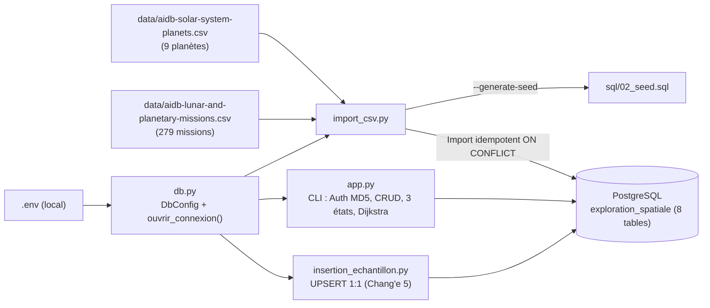

# Architecture Globale & Choix de Modélisation (`devoirBDD`)

> Document de référence complet du projet **Exploration Spatiale & Planétologie** : intégration des 2 datasets CSV réels sans sur-extension du schéma (8 tables 3NF), règles `ON DELETE`, mots-clés PostgreSQL, graphe orienté pondéré, sécurité `md5()` et architecture Python.

---

## 1. Cas pratique & intégration des 2 jeux de données CSV

Le projet repose désormais directement sur **deux bases de données réelles** placées dans `data/` tout en conservant exactement **8 tables** en 3e Forme Normale (aucune table superflue créée) :

1. **[`data/aidb-solar-system-planets.csv`](../data/aidb-solar-system-planets.csv)** (9 enregistrements) :
   * Alimente `corps_celeste` avec les 8 planètes + Pluton et leurs **mesures physiques exactes** (`code_wikidata`, `type_corps`, `distance_soleil_ua`, `diametre_km`, `masse_kg`, `gravite_m_s2`, `vitesse_liberation_km_s`, `periode_orbitale_jours`, `temperature_moyenne_c`, `nb_lunes`, `a_des_anneaux`, `champ_magnetique`, `date_decouverte`).
2. **[`data/aidb-lunar-and-planetary-missions.csv`](../data/aidb-lunar-and-planetary-missions.csv)** (279 missions historiques, 1957–2025) :
   * Alimente intégralement `mission` (`nom_mission`, `date_lancement`, `pays_operateur`, `type_mission`, `tentative`, `echec_lancement`, `lanceur`, `masse_kg`) — **zéro mission inventée**.
   * Fournit les **6 cibles non-planétaires** de la colonne `target` (`Moon`, `Titan`, `Ganymede`, `Sun`, `Asteroid`, `Comet`), intégrées dans `corps_celeste` avec leurs colonnes physiques laissées à `NULL` (aucune donnée physique inventée).
   * La cible `'Earth / near-Earth space'` est rattachée à `'Earth'` (priorité aux planètes du CSV sans doublon).
   * Les **3 missions dont `target` est vide** dans le CSV (`Zond 4`, `Kepler`, `Q-PACE`) ont `mission.id_corps = NULL` pour éviter d'inventer une cible fictive.

### Ce qui vient des CSV vs ce qui complète les exigences du cours

| Table | Source des données | Rôle dans les consignes |
| :--- | :--- | :--- |
| `corps_celeste` (15) | **100 % issue des 2 CSV** (9 planètes + 6 cibles `target`) | Sommets du graphe + catalogue astronomique (`Uranus` et `Neptune` sans mission cible dédiée ➔ idéal pour le `LEFT JOIN` de l'État 2) |
| `mission` (279) | **100 % issue de `missions.csv`** (aucune mission inventée) | Cœur métier, relations `0..1:N` vers `corps_celeste` et `utilisateur` |
| `profil` (3) & `utilisateur` (4) | Complément pédagogique (absent des CSV) | Gestion des profils et mots de passe hachés (`md5`) |
| `trajectoire_orbitale` (19) | Complément pédagogique sur les **15 vrais astres CSV** | Graphe orienté et pondéré à double sens + Dijkstra |
| `instrument_scientifique` (7) & `mission_instrument` (9) | Complément pédagogique rattaché à **de vraies missions du CSV** | Association `M:N` (`Mars 2020`, `Mars Science Laboratory`, `Cassini`, `Rosetta`, `JUICE`, `Voyager 1`) |
| `echantillon` (5 + `Chang'e 5`) | Complément pédagogique rattaché à **de vraies missions du CSV** | Relation `1:1` stricte (`Apollo 11`, `Mars 2020`, `OSIRIS-REx`, `Hayabusa 2`, `Stardust`) |

---

## 2. Normalisation 3NF et mots-clés PostgreSQL

### Garantie 3NF sur 8 tables
* **1NF (Atomicité)** : chaque attribut stocke une seule valeur élémentaire.
* **2NF (Dépendance complète à la clé primaire)** : dans `mission_instrument`, l'attribut `role` dépend du couple `(id_mission, id_instrument)` entier.
* **3NF (Aucune dépendance transitive)** :
  * Les permissions (`peut_ecrire`, `peut_supprimer`, `description`) sont isolées dans `profil` plutôt que répétées dans chaque ligne de `utilisateur`.
  * Les mesures physiques (`diametre_km`, `gravite_m_s2`, etc.) vivent uniquement dans `corps_celeste` et jamais dans `mission`.
  * *Pourquoi ne pas créer une table séparée `pays` ou `lanceur` ?* Dans le CSV des missions, aucun attribut secondaire ne dépend du pays ni du lanceur : les conserver dans `mission` respecte déjà la 3NF tout en gardant un schéma compact à 8 tables très lisible à l'oral.

### Mots-clés SQL en PostgreSQL : `description` vs `user` vs `role`

Une interrogation fréquente lors de la lecture de [`sql/01_schema.sql`](../sql/01_schema.sql) concerne la coloration syntaxique dans l'IDE (qui peut colorer `description` ou `role` en bleu). Vérification directe dans le catalogue système de PostgreSQL (`pg_get_keywords()`) :

| Identifiant | Statut dans PostgreSQL (`pg_get_keywords()`) | Conséquence |
| :--- | :--- | :--- |
| `description` | **Pas un mot-clé PostgreSQL** (absent du catalogue) | Aucun problème ni ambiguïté. La coloration provient d'une grammaire SQL générique de l'éditeur. |
| `role` | **Mot-clé non réservé (`U`)** | Utilisable sans guillemets comme nom de colonne dans PostgreSQL. |
| `user` | **Mot-clé réservé (`R`)** | Interdit sans guillemets (entre en conflit avec la fonction SQL `USER` / `CURRENT_USER`). C'est pourquoi la table est nommée **`utilisateur`**. |

---

## 3. Comprendre les clauses `ON DELETE` en PostgreSQL

Lorsqu'une table enfant possède une clé étrangère (`FOREIGN KEY`) pointant vers une table parente, que doit faire PostgreSQL si l'on tente de supprimer la ligne parente ? Il existe **5 comportements** :

| Clause `ON DELETE` | Comportement lors d'un `DELETE` sur le parent | Différence clé / usage typique |
| :--- | :--- | :--- |
| **`NO ACTION`** *(comportement par défaut si on ne précise rien)* | **Refuse** la suppression s'il reste des lignes enfants référençant le parent. | Le contrôle peut être **différé à la fin de la transaction** (`DEFERRABLE INITIALLY DEFERRED`) si une contrainte différable est configurée. |
| **`RESTRICT`** | **Refuse immédiatement** la suppression s'il existe au moins une ligne enfant. | Même effet pratique que `NO ACTION` hors transaction différée, mais **non différable** (contrôle immédiat garanti) et **documente explicitement l'intention** dans le DDL (prouve qu'on a choisi d'interdire la suppression au lieu d'oublier la clause). |
| **`CASCADE`** | **Supprime automatiquement** toutes les lignes enfants rattachées au parent supprimé. | Utile pour les entités « faibles » ou tables de liaison qui n'ont aucun sens sans leur parent. |
| **`SET NULL`** | Met la clé étrangère des enfants à **`NULL`** et conserve les lignes enfants. | Utile pour les liens optionnels (ex. un responsable qui quitte l'organisation : on ne veut pas supprimer ses missions). |
| **`SET DEFAULT`** | Remplace la clé étrangère des enfants par sa **valeur `DEFAULT`**. | Rare ; utile uniquement si une valeur parent par défaut existe (ex. un profil par défaut). |

### Justification de chaque `ON DELETE` dans notre schéma (`sql/01_schema.sql`)

| Clé étrangère | Clause choisie | Pourquoi ce choix précis ? |
| :--- | :--- | :--- |
| `utilisateur.id_profil -> profil` | **`ON DELETE RESTRICT`** | Interdit de supprimer un profil (`administrateur`, `scientifique`...) tant que des comptes utilisateurs l'utilisent encore. |
| `mission.id_corps -> corps_celeste` | **`ON DELETE RESTRICT`** | Interdit de supprimer une planète (`Mars`, `Moon`...) par erreur si des missions historiques la ciblent encore. |
| `mission_instrument.id_instrument -> instrument_scientifique` | **`ON DELETE RESTRICT`** | Empêche de retirer un instrument du catalogue tant qu'il est déclaré embarqué sur une mission. |
| `mission.id_responsable -> utilisateur` | **`ON DELETE SET NULL`** | Si un compte utilisateur est supprimé, les missions historiques qu'il supervisait restent en base avec `id_responsable = NULL`. |
| `mission_instrument.id_mission -> mission` | **`ON DELETE CASCADE`** | Supprimer une mission (ex. en démo CLI) nettoie automatiquement ses affectations dans la table de liaison `M:N`. |
| `echantillon.id_mission -> mission` | **`ON DELETE CASCADE`** | Un échantillon `1:1` dépend entièrement de sa mission : supprimer la mission supprime son échantillon associé. |
| `trajectoire_orbitale.(depart/arrivee) -> corps_celeste` | **`ON DELETE CASCADE`** | Une arête du graphe orbital n'a plus de sens si l'un de ses deux sommets est supprimé. |

---

## 4. Architecture du graphe orienté et pondéré (double sens autorisé)

En base relationnelle, un graphe orienté et pondéré $G = (V, E, w)$ repose sur deux tables :
1. **Sommets $V$** : les 15 enregistrements de `corps_celeste` (issus des 2 CSV).
2. **Arêtes orientées et pondérées $E$** : les 19 lignes de `trajectoire_orbitale`, référençant deux fois `corps_celeste` (`id_corps_depart`, `id_corps_arrivee`) avec deux poids strictement positifs (`delta_v_ms`, `duree_jours`).

```sql
CONSTRAINT uq_trajectoire_orientee UNIQUE (id_corps_depart, id_corps_arrivee),
CONSTRAINT chk_corps_differents CHECK (id_corps_depart <> id_corps_arrivee)
```

* `CHECK (id_corps_depart <> id_corps_arrivee)` interdit les boucles (`Mars -> Mars`).
* `UNIQUE (id_corps_depart, id_corps_arrivee)` autorise le **double sens asymétrique** (`Earth -> Moon` = `13 200 m/s` vs `Moon -> Earth` = `2 800 m/s` grâce à la faible gravité lunaire et à l'aérofreinage) tout en interdisant les arêtes dupliquées.
* **Exploitation Dijkstra dans [`app.py`](../app.py) :**
  * `Earth -> Jupiter` en **Δv** : direct (`16 500 m/s`, `1 800 j`).
  * `Earth -> Jupiter` en **durée** : `Earth -> Mars -> Jupiter` (`1 160 j`, `18 800 m/s`).
  * `Earth -> Neptune` : `Earth -> Jupiter -> Saturn -> Uranus -> Neptune` (Grand Tour planétaire).

---

## 5. Profils utilisateurs et sécurité des mots de passe

1. **Secrets infrastructure (`.env`)** : le mot de passe PostgreSQL local (`PGPASSWORD`) vit uniquement dans `.env` (ignoré par `.gitignore`), chargé par [`db.py`](../db.py).
2. **Authentification applicative (`utilisateur` + `profil`)** :
   * Les mots de passe ne sont **jamais stockés en clair** ; PostgreSQL stocke `md5(mot_de_passe)` dans `utilisateur.password_hash`.
   * La connexion vérifie `WHERE u.username = %s AND u.password_hash = md5(%s)` et charge les droits (`peut_ecrire`, `peut_supprimer`) depuis `profil`.
   * *Note critique pour l'oral* : `md5()` répond directement à l'exemple du cours sans extension PostgreSQL ; en production réelle on utiliserait un hachage lent et salé (**Argon2id** / **bcrypt**).

---

## 6. Architecture logicielle Python et synchronisation CSV



* [`import_csv.py`](../import_csv.py) sert à la fois de **chargeur direct idempotent** des 2 CSV dans PostgreSQL (`ON CONFLICT ... DO UPDATE`, priorité aux CSV) et de **générateur exact** de [`sql/02_seed.sql`](../sql/02_seed.sql) (`--generate-seed`) pour que le déploiement pur SQL (`01_schema.sql` ➔ `02_seed.sql` ➔ `03_queries.sql`) fonctionne sans étape préalable.
