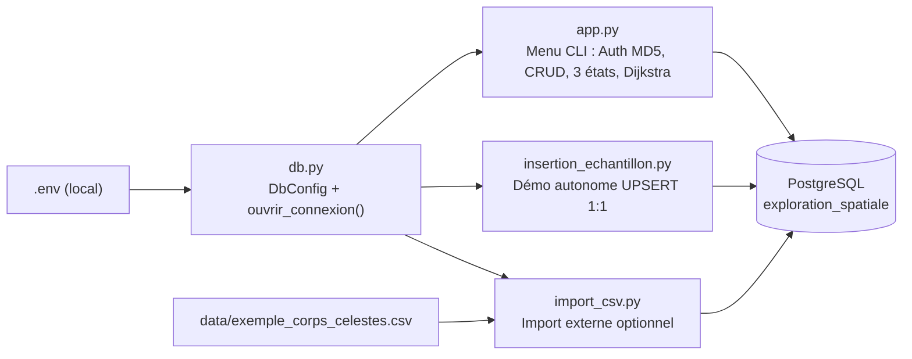

# Architecture Globale & Choix de Modélisation (`devoirBDD`)

> Document de référence expliquant le projet **Exploration Spatiale & Planétologie** de bout en bout : besoin métier, normalisation 3NF sur 8 tables, graphe orienté pondéré, sécurité des mots de passe, architecture Python et ouverture vers des données externes.

---

## 1. Le cas pratique et le besoin métier

Le projet modélise le système d'information d'un centre de suivi des **missions d'exploration spatiale et planétologique**.  
Il répond à quatre besoins concrets :

1. **Recenser les corps célestes et planifier les trajets orbitaux** entre eux (en mesurant l'énergie nécessaire Δv et la durée de transit, différentes à l'aller et au retour).
2. **Suivre les missions spatiales** (agence, statut, astre ciblé, responsable scientifique) et les **instruments embarqués** avec leur rôle précis.
3. **Assurer la traçabilité géologique** des échantillons uniques ramenés ou analysés par chaque mission.
4. **Contrôler l'accès des utilisateurs** selon leur profil métier (`administrateur`, `scientifique`, `observateur`) sans jamais stocker leurs mots de passe en clair.

---

## 2. Modélisation relationnelle (8 tables en 3NF)

Le schéma défini dans [`sql/01_schema.sql`](../sql/01_schema.sql) repose sur **8 tables entièrement connectées** (aucune table isolée) respectant la **3e Forme Normale (3NF)** :

* **1NF (Atomicité)** : chaque colonne contient une seule valeur indivisible (ex. jamais une liste d'instruments séparés par des virgules dans `mission`).
* **2NF (Dépendance complète à la clé primaire)** : dans la table d'association `mission_instrument`, l'attribut `role` dépend du couple `(id_mission, id_instrument)` entier — le même instrument peut avoir un rôle différent sur deux missions distinctes.
* **3NF (Aucune dépendance transitive)** :
  * Les droits (`peut_ecrire`, `peut_supprimer`, `description`) sont isolés dans la table `profil` et non dupliqués dans `utilisateur` : si on les laissait dans `utilisateur`, ils dépendraient du nom du profil plutôt que de `id_utilisateur`.
  * Les caractéristiques d'un astre (`type_corps`, `distance_soleil_ua`) vivent uniquement dans `corps_celeste` et jamais dans `mission`.

### Justifications métier des cardinalités

| Type | Exemple dans le schéma | Règle métier qui l'impose |
| :--- | :--- | :--- |
| **`1:N`** | `corps_celeste` (1) ➔ `mission` (N) | Un astre (ex. *Mars*) peut recevoir plusieurs missions (*Perseverance*, *Curiosity*), mais chaque mission vise un seul astre cible principal. |
| **`1:N`** | `profil` (1) ➔ `utilisateur` (N) | Plusieurs utilisateurs partagent un même profil de droits (`administrateur`, `scientifique`, `observateur`), et chaque compte appartient à un seul profil. |
| **`0..1 : N`** | `utilisateur` (0..1) ➔ `mission` (N) | Un scientifique peut superviser plusieurs missions ; une mission peut avoir un responsable ou aucun (`NULL`, utile en cas d'import externe). |
| **`M:N`** | `mission` (M) 🡘 `instrument_scientifique` (N) via `mission_instrument` | Une mission embarque plusieurs instruments (*Perseverance* a *SuperCam*, *Mastcam-Z* et *PIXL*) et un même modèle d'instrument peut équiper plusieurs missions (*Mastcam-Z* sur *Perseverance* et *Artemis III*). |
| **`M:N` réflexive** | `corps_celeste` 🡘 `corps_celeste` via `trajectoire_orbitale` | Un astre peut être le départ et/ou l'arrivée de plusieurs trajectoires orientées vers d'autres astres. |
| **`1:1`** | `mission` (1) 🡘 `echantillon` (0..1) | Contrainte `UNIQUE` sur `echantillon.id_mission` : chaque mission dispose au maximum d'un échantillon géologique de référence. |

### Intégrité référentielle (`ON DELETE`)

Les politiques de suppression sont choisies selon la logique métier :
* `ON DELETE RESTRICT` sur `mission.id_corps`, `utilisateur.id_profil` et `mission_instrument.id_instrument` : interdit de supprimer un astre, un profil ou un instrument tant qu'il est encore référencé.
* `ON DELETE CASCADE` sur `mission_instrument.id_mission`, `echantillon.id_mission` et `trajectoire_orbitale` : supprimer une mission nettoie automatiquement ses affectations d'instruments et son échantillon associé.
* `ON DELETE SET NULL` sur `mission.id_responsable` : si un compte utilisateur quitte le projet, les missions qu'il supervisait ne sont pas détruites.

---

## 3. Architecture du graphe orienté et pondéré (double sens autorisé)

En base de données relationnelle, un **graphe orienté et pondéré** $G = (V, E, w)$ se modélise proprement par deux tables :

1. **L'ensemble des sommets $V$** : la table `corps_celeste` (`Terre`, `Lune`, `Mars`, `Europe`, `Titan`, `Encelade`, `67P/Tchourioumov`).
2. **L'ensemble des arêtes orientées et pondérées $E$** : la table `trajectoire_orbitale`, qui référence **deux fois** `corps_celeste` :
   * `id_corps_depart` : sommet source,
   * `id_corps_arrivee` : sommet cible,
   * `delta_v_ms` : premier poids positif (coût énergétique en m/s),
   * `duree_jours` : second poids positif (temps de transit en jours).

### Pourquoi deux contraintes clés assurent un graphe propre

```sql
CONSTRAINT uq_trajectoire_orientee UNIQUE (id_corps_depart, id_corps_arrivee),
CONSTRAINT chk_corps_differents CHECK (id_corps_depart <> id_corps_arrivee)
```

* **`CHECK (id_corps_depart <> id_corps_arrivee)`** : empêche une boucle absurde (`Mars -> Mars`).
* **`UNIQUE (id_corps_depart, id_corps_arrivee)`** : empêche d'enregistrer deux fois la même arête `Terre -> Mars`, **tout en autorisant la paire inverse `Mars -> Terre`** comme seconde ligne distincte.
* **Intérêt réel de l'orientation et de l'asymétrie :**
  * `Terre -> Lune` coûte `13 200 m/s` (arrachement à la gravité terrestre + alunissage), alors que `Lune -> Terre` ne coûte que `2 800 m/s` (faible gravité lunaire + aérofreinage terrestre).
  * En SQL (`Requête 4` de [`03_queries.sql`](../sql/03_queries.sql)), une auto-jointure `LEFT JOIN` sur `trajectoire_orbitale` détecte automatiquement si chaque liaison est **`Double sens`** ou **`Sens unique`**.
  * En Python ([`app.py`](../app.py)), l'algorithme de **Dijkstra** calcule le chemin optimal entre deux astres selon le critère choisi :
    * `Terre -> Europe` en **énergie (`delta_v_ms`)** ➔ trajet direct (`16 500 m/s`, `1 800 j`).
    * `Terre -> Europe` en **durée (`duree_jours`)** ➔ `Terre -> Mars -> Europe` (`1 160 j`, `18 800 m/s`).
    * `Terre -> Encelade` (aucune liaison directe) ➔ chemin multi-étapes passant par `Europe` et `Titan`.

---

## 4. Gestion des profils et sécurité des mots de passe

### Deux niveaux d'authentification bien séparés

Il est important de ne pas confondre les deux niveaux de sécurité du projet :

1. **Accès technique au serveur PostgreSQL (`.env`) :**
   * Le mot de passe du serveur PostgreSQL local (`PGPASSWORD`) n'est **jamais** dans le code Python ni sur GitHub ; il réside dans `.env` (exclu par `.gitignore`).
2. **Authentification applicative par profil (`utilisateur` + `profil`) :**
   * Conformément à la consigne du cours, les mots de passe des utilisateurs ne sont **jamais stockés en clair** dans la base.
   * Lors de la création d'un compte (`02_seed.sql` ou option `11` de `app.py`), on enregistre `md5(mot_de_passe)` dans `utilisateur.password_hash`.
   * Lors de la connexion, Python exécute une requête paramétrée :
     ```sql
     SELECT u.id_utilisateur, u.username, u.nom_complet,
            p.nom_profil, p.peut_ecrire, p.peut_supprimer
     FROM utilisateur u
     INNER JOIN profil p ON u.id_profil = p.id_profil
     WHERE u.username = %s AND u.password_hash = md5(%s);
     ```
   * Selon les booléens du profil récupéré, `app.py` autorise ou refuse les écritures et suppressions :
     * `observateur` : consultation des états et du graphe uniquement.
     * `scientifique` : consultation + insertion + modification (suppression refusée).
     * `administrateur` : accès total (incluant suppression et création de comptes).

> [!NOTE]
> **Point critique à connaître pour l'oral :** `md5()` est utilisé ici parce qu'il est natif dans PostgreSQL sans extension et correspond exactement à l'exemple présenté en cours (`SELECT md5('password')`). Dans une application de production exposée sur Internet, MD5 est aujourd'hui trop rapide et vulnérable aux attaques par dictionnaire / tables arc-en-ciel : on le remplacerait par un hachage **lent et salé** comme **Argon2id** ou **bcrypt** (via `pgcrypto` ou côté Python). La colonne `password_hash VARCHAR(64)` a déjà été dimensionnée pour faciliter une telle évolution.

---

## 5. Architecture logicielle Python



* **[`db.py`](../db.py)** : centralise le réglage UTF-8 Windows (`isinstance(..., io.TextIOWrapper)`), le chargement `.env` dans une `dataclass DbConfig` et l'ouverture de connexion `psycopg.connect(...)` avec arguments nommés (typage strict Pylance, zéro duplication de code).
* **[`app.py`](../app.py)** : programme principal en ligne de commande couvrant 100 % des opérations attendues en démonstration, avec protection anti-injection SQL (`%s`), gestion d'erreurs `psycopg.Error` + `conn.rollback()` et algorithme de Dijkstra (`heapq`).
* **[`insertion_echantillon.py`](../insertion_echantillon.py)** : script court conservé pour illustrer isolément le mécanisme `ON CONFLICT (id_mission) DO UPDATE` de la relation `1:1`.
* **[`import_csv.py`](../import_csv.py)** : utilitaire léger totalement indépendant permettant d'intégrer un fichier CSV externe si le groupe décide d'enrichir le catalogue.

---

## 6. Préparation légère à l'accueil d'une base externe

Sans alourdir ni dénaturer le modèle 3NF, quatre précautions discrètes rendent le projet prêt à absorber un jeu de données trouvé sur Internet (ex. catalogue NASA / JPL / Kaggle) :

1. **Tailles de colonnes généreuses** (`VARCHAR(100)`, `NUMERIC(10,3)` pour les distances, `NUMERIC(10,2)` pour les masses) pour éviter les troncatures sur des noms longs ou des astres très éloignés.
2. **Colonnes optionnelles tolérantes** : `corps_celeste.distance_soleil_ua` et `mission.id_responsable` acceptent `NULL` si la source externe ne fournit pas ces champs.
3. **Clés `UNIQUE` naturelles** (`corps_celeste.nom`, `mission.nom_mission`, etc.) permettant des imports relançables sans doublons via `ON CONFLICT (...) DO NOTHING`.
4. **Script optionnel [`import_csv.py`](../import_csv.py)** : utilise uniquement le module standard `csv`, propose un dictionnaire `COLONNES_CSV` pour mapper des en-têtes anglais ou français, et un mode `--dry-run` pour vérifier le fichier avant toute insertion réelle. Si la base externe n'est finalement pas retenue, ce script peut être ignoré ou supprimé sans aucun impact sur `app.py` ni sur les scripts SQL.
