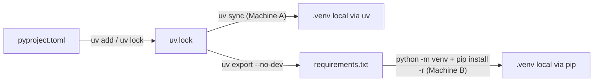

# Gestion de l'Environnement Python (`uv` + `venv` classique)

Ce document explique l'architecture choisie pour partager le projet **devoirBDD** entre un développeur utilisant **`uv`** et un collaborateur utilisant **`python -m venv` + `pip`**.

---

## 1. Pourquoi ne pas commiter `.venv/` sur Git ?

Un dossier `.venv/` ne doit **jamais** être versionné dans Git pour trois raisons techniques :

1. **Chemins absolus et liens symboliques liés à la machine :** sur Windows, `.venv/Scripts/*.exe` et `pyvenv.cfg` encodent le chemin exact de l'interpréteur Python local (ex. `C:\Users\guill\...`). Copié sur le PC d'un collègue, l'environnement virtuel échoue ou pointe vers un interpréteur inexistant.
2. **Dépendance à l'OS et à la version Python :** les paquets compilés comme `psycopg-binary` contiennent des binaires natifs (`.pyd` Windows vs `.so` Linux/macOS) propres à une architecture et une version Python précises.
3. **Volume inutile dans Git :** des dizaines de mégaoctets de bibliothèques tierces alourdissent l'historique du dépôt.

---

## 2. La solution hybride retenue (`pyproject.toml` + `uv.lock` + `requirements.txt`)

Le dépôt embarque trois fichiers complémentaires à sa racine :

| Fichier | Rôle | Utilisé par |
| :--- | :--- | :--- |
| `pyproject.toml` | Déclare le projet, la version Python minimale (`>=3.11`) et les dépendances directes (`psycopg[binary]`, `python-dotenv`). | `uv` et outils PEP 621 |
| `uv.lock` | Verrouille les versions exactes et hashes de toutes les dépendances pour une reproductibilité stricte. | Développeur avec `uv` |
| `requirements.txt` | Liste plate exportée directement depuis `uv.lock` (sans dépendances de dev ni hashes bloquants). | Collaborateur avec `venv` + `pip` |
| `.python-version` | Indique la version Python recommandée (`3.12`) pour `uv`. | `uv` |



---

## 3. Commandes de maintenance (côté mainteneur avec `uv`)

Lorsqu'une nouvelle bibliothèque est ajoutée ou retirée :

```powershell
# 1. Ajouter ou retirer une dépendance via uv
uv add <nom_du_package>

# 2. Mettre à jour requirements.txt pour les collaborateurs sans uv
uv export --format requirements.txt --no-hashes --no-dev --no-emit-project -o requirements.txt
```

> 💡 L'option `--no-dev` évite d'imposer au collaborateur l'installation des outils de développement locaux comme `ruff`, et `--no-emit-project` évite d'inscrire un paquet éditable superflu dans `requirements.txt`.

---

## 4. Commandes côté collaborateur (sans `uv`)

Le collaborateur clone simplement le dépôt, crée son propre `.venv` local en une commande, et installe exactement les mêmes versions figées :

```powershell
# Windows (PowerShell)
python -m venv .venv
.\.venv\Scripts\Activate.ps1
pip install -r requirements.txt
```

```bash
# Linux / macOS
python3 -m venv .venv
source .venv/bin/activate
pip install -r requirements.txt
```
