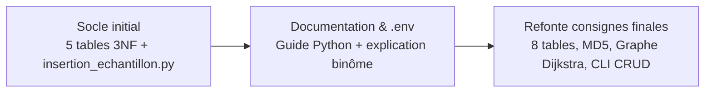

# Historique Synthétique du Projet (`devoirBDD`)

## Socle Ancien *(compacté)*
* Initialisation du dépôt Git (`GuillaumeWnt/devoirBDD`), environnement hybride `uv` + `requirements.txt`, schéma 3NF initial à 5 tables (`corps_celeste`, `mission`, `instrument_scientifique`, `mission_instrument`, `echantillon`), script `insertion_echantillon.py` sécurisé par `.env` et documentation de base.

## Évolution Récente *(synthétique)*
* Rédaction d'une explication détaillée du rôle de Python face au SQL et décryptage des 7 syntaxes clés dans [`docs/role-script-python.md`](role-script-python.md).
* Enrichissement de [`README.md`](../README.md) pour expliquer au binôme la séparation `.env.example` / `.env` dans le cadre du partage GitHub.

## Session Courante *(détaillée)*
* Extension du modèle 3NF de 5 à **8 tables** dans [`sql/01_schema.sql`](../sql/01_schema.sql) : ajout de `profil`, `utilisateur` (mots de passe hachés `md5()`), `trajectoire_orbitale` (graphe orienté pondéré à double sens), et dimensionnement souple pour un éventuel import externe.
* Mise à jour de [`sql/02_seed.sql`](../sql/02_seed.sql) (3 profils, 4 comptes MD5 dont `tlenfant`, 7 astres, 11 trajectoires orientées) et [`sql/03_queries.sql`](../sql/03_queries.sql) (3 états multi-tables + graphe + authentification MD5).
* Création de [`db.py`](../db.py) (typage Pylance propre), de l'application CLI complète [`app.py`](../app.py) (authentification MD5 par profil, CRUD complet avec vérifications, 3 états, Dijkstra) et de l'utilitaire optionnel [`import_csv.py`](../import_csv.py) + [`data/exemple_corps_celestes.csv`](../data/exemple_corps_celestes.csv).
* Réorganisation complète de la documentation ([`DIAGRAMME.md`](../DIAGRAMME.md), [`README.md`](../README.md), [`docs/architecture-et-modele.md`](architecture-et-modele.md), [`docs/guide-oral-et-demo.md`](guide-oral-et-demo.md), [`docs/role-script-python.md`](role-script-python.md)).
