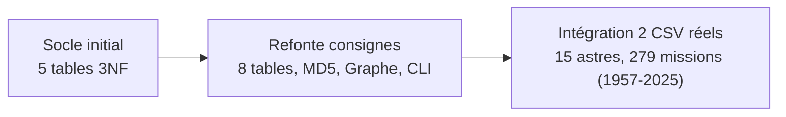

# Historique Synthétique du Projet (`devoirBDD`)

## Socle Ancien *(compacté)*
* Création du dépôt `GuillaumeWnt/devoirBDD` (`uv` + `requirements.txt`), schéma initial 5 tables 3NF, protection `.env` pour le partage GitHub et guide pédagogique Python/SQL.

## Évolution Récente *(synthétique)*
* Extension du schéma à **8 tables 3NF** (`profil`, `utilisateur` MD5, `trajectoire_orbitale` graphe orienté pondéré double sens), création de `db.py` (zéro erreur Pylance) et de l'application CLI complète `app.py` (auth MD5, CRUD vérifié, 3 états, Dijkstra), puis alignement des directives locales (`AGENTS.md`, `.agents/`).

## Session Courante *(détaillée)*
* Intégration directe des 2 bases CSV ajoutées dans `data/` (`aidb-solar-system-planets.csv` et `aidb-lunar-and-planetary-missions.csv`) **en conservant exactement 8 tables** : enrichissement de `corps_celeste` (15 astres : 9 planètes + 6 cibles réelles) et `mission` (279 vraies missions 1957–2025, `id_corps` nullable pour les 3 missions sans cible), **zéro astre ni mission inventé**, priorité aux nouveaux CSV et suppression de l'ancien gabarit `data/exemple_corps_celestes.csv`.
* Transformation de [`import_csv.py`](../import_csv.py) en chargeur officiel idempotent des 2 CSV + générateur exact de [`sql/02_seed.sql`](../sql/02_seed.sql).
* Adaptation de [`sql/03_queries.sql`](../sql/03_queries.sql), [`app.py`](../app.py) (filtrage des 279 missions, 3 états actualisés, Dijkstra sur les vrais astres) et [`insertion_echantillon.py`](../insertion_echantillon.py) (UPSERT sur la vraie mission `Chang'e 5`).
* Mise à jour complète de la documentation (`DIAGRAMME.md`, `README.md`, `docs/`) incluant l'explication détaillée des 5 clauses `ON DELETE` et des mots-clés PostgreSQL (`description` vs `user`).
