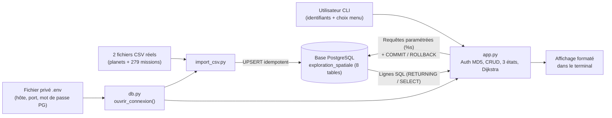

# À quoi sert la couche Python par rapport aux fichiers SQL ?

> Guide pédagogique pour comprendre le rôle concret des programmes Python ([`db.py`](../db.py), [`app.py`](../app.py), [`insertion_echantillon.py`](../insertion_echantillon.py), [`import_csv.py`](../import_csv.py)) face aux scripts SQL statiques, suivi d'un décryptage simple des syntaxes Python et PostgreSQL utilisées.

---

## 1. La problématique initiale : pourquoi les fichiers SQL ne suffisent pas ?

Les trois fichiers `.sql` sont parfaits pour **construire** et **interroger manuellement** la base de données, mais ils sont **statiques** : ils ne savent pas faire tourner une vraie application interactive.

| Besoin concret | Fichiers `.sql` seuls | Programmes Python (`db.py`, `app.py`, `import_csv.py`) |
| :--- | :--- | :--- |
| **Quand les lance-t-on ?** | À la main dans `psql` ou pgAdmin, au déploiement. | À tout moment via un menu interactif CLI ou lors de l'import des CSV. |
| **Origine des données** | Figées dans le fichier `.sql`. | Lues depuis les 2 fichiers CSV de `data/` ([`import_csv.py`](../import_csv.py)) ou saisies en direct dans [`app.py`](../app.py). |
| **Sécurité des entrées** | Coller du texte brut dans du SQL expose aux injections SQL ou plante sur une apostrophe (`Chang'e 5`). | Utilise des **requêtes paramétrées (`%s`)** : sépare strictement le code SQL des valeurs. |
| **Secrets et collaboration GitHub** | Un `.sql` ne sait pas lire un fichier `.env` local. | Lit le fichier privé `.env` (ignoré par Git) pour ne jamais exposer le mot de passe PostgreSQL sur GitHub. |
| **Authentification et profils** | Ne sait pas gérer une session utilisateur ni bloquer un menu. | Vérifie `username` + `md5(%s)` côté PostgreSQL, puis autorise ou refuse écritures/suppressions selon le profil. |
| **Algorithmes sur graphe** | Calculer un plus court chemin pondéré multi-critères est complexe en pur SQL. | Charge `trajectoire_orbitale` depuis PostgreSQL et exécute **Dijkstra** (`heapq`) sur les 15 astres. |

### L'image simple pour retenir la différence

* **PostgreSQL + les fichiers `.sql`**, c'est une **bibliothèque avec ses étagères et son règlement** :
  * `01_schema.sql` construit les 8 étagères et les contraintes (`UNIQUE`, `CHECK`, `ON DELETE`).
  * `02_seed.sql` range les données initiales (les 15 corps célestes et 279 missions réelles des 2 CSV + profils, trajectoires, instruments et échantillons).
  * `03_queries.sql` rassemble les 3 états officiels et requêtes d'analyse.
* **Les programmes Python (`psycopg`)**, c'est le **logiciel d'accueil qui fait vivre la bibliothèque** :
  * [`db.py`](../db.py) ouvre la connexion sécurisée via `.env`.
  * [`app.py`](../app.py) authentifie l'utilisateur, filtre les 279 missions par mot-clé, gère le CRUD avec preuves, affiche les 3 états et calcule des itinéraires Dijkstra.
  * [`import_csv.py`](../import_csv.py) lit directement les 2 vrais CSV de `data/`, les synchronise dans PostgreSQL (`ON CONFLICT ... DO UPDATE`) et peut régénérer `sql/02_seed.sql` (`--generate-seed`).
  * [`insertion_echantillon.py`](../insertion_echantillon.py) fournit une petite démo isolée de l'UPSERT `1:1` sur la vraie mission `Chang'e 5`.

---

## 2. Vue d'ensemble des échanges entre CSV, Python et PostgreSQL



---

## 3. Décryptage des syntaxes Python & SQL importantes

### 3.1. La flèche `-> None` et les annotations de type

```python
def configurer_sortie_utf8() -> None:
def charger_config_db() -> DbConfig:
```

* La flèche `->` placée avant `:` est une **annotation de type de retour** (*type hint*) : elle indique au lecteur et à l'IDE ce que la fonction renvoie avec `return`.
* `-> None` signifie que la fonction effectue une action sans renvoyer de valeur.
* Une notation comme `dict[str, str | int]` signifie : dictionnaire à clés texte (`str`) et valeurs texte ou (`|`) entier (`int`). Dans [`db.py`](../db.py), nous utilisons la `@dataclass` `DbConfig` pour un typage encore plus propre et sans alerte Pylance.

### 3.2. Construire le chemin vers `.env` avec `Path`

```python
env_path = Path(__file__).resolve().parent / ".env"
```

| Morceau | Rôle | Exemple concret (Windows) |
| :--- | :--- | :--- |
| `__file__` | Chemin du script Python en cours d'exécution. | `db.py` |
| `Path(__file__).resolve()` | Transforme en objet `Path` et donne le chemin absolu. | `C:\Users\...\devoirBDD\db.py` |
| `.parent` | Remonte d'un cran vers le **dossier parent**. | `C:\Users\...\devoirBDD` |
| `/ ".env"` | Avec `pathlib`, `/` **colle** le nom de fichier au dossier. | `C:\Users\...\devoirBDD\.env` |

### 3.3. Le dépaquetage `**dictionnaire` (et pourquoi `db.py` passe des arguments nommés)

En Python, `fonction(**dico)` ouvre le dictionnaire en arguments nommés `clé=valeur` (ex. `dbname=...`, `port=...`). Dans [`db.py`](../db.py), passer explicitement `psycopg.connect(dbname=cfg.dbname, ...)` garantit une vérification statique parfaite sous Pylance.

### 3.4. `ON CONFLICT ... DO UPDATE`, `EXCLUDED` et `RETURNING`

```sql
ON CONFLICT (id_mission) DO UPDATE
    SET code_tube = EXCLUDED.code_tube,
        type_roche = EXCLUDED.type_roche,
        masse_grammes = EXCLUDED.masse_grammes
RETURNING id_echantillon;
```

1. **`ON CONFLICT (id_mission) DO UPDATE` (UPSERT)** : si la mission possède déjà un échantillon (contrainte `1:1` `UNIQUE (id_mission)`), PostgreSQL met à jour la ligne existante au lieu de lever une erreur de doublon.
2. **`EXCLUDED`** : désigne les nouvelles valeurs candidates rejetées par le conflit (`SET code_tube = EXCLUDED.code_tube` remplace l'ancienne valeur par la nouvelle).
3. **`RETURNING id_echantillon;`** : renvoie immédiatement à Python l'identifiant créé ou mis à jour.

### 3.5. `fetchone()`, `row_id[0]`, `fetchall()` et alignement `:<11` / `:>8`

* `row_id = cur.fetchone()` lit **1 seule ligne** (renvoyée sous forme de tuple à 1 élément, ex. `(6,)`, ou `None`). Après garde-fou `if row_id is None:`, `row_id[0]` extrait l'entier `6`.
* `rows = cur.fetchall()` lit **toutes les lignes** d'un `SELECT` dans une liste de tuples ; la boucle `for row in rows:` accède aux colonnes dans l'ordre du `SELECT` (`row[0]`, `row[1]`, ...).
* Dans une *f-string* (`f"..."`), `:<11` aligne à **gauche** sur au moins 11 caractères et `:>8` aligne à **droite** sur au moins 8 caractères pour garder un tableau bien aligné dans le terminal.
