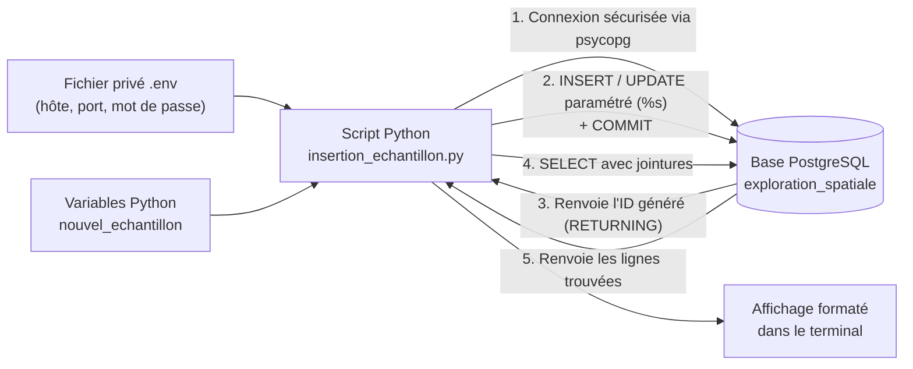

# À quoi sert le script Python par rapport aux fichiers SQL ?

> Guide pédagogique pour comprendre le rôle exact de [`insertion_echantillon.py`](../insertion_echantillon.py), ce qu'il résout par rapport à [`01_schema.sql`](../sql/01_schema.sql), [`02_seed.sql`](../sql/02_seed.sql) et [`03_queries.sql`](../sql/03_queries.sql), et comment il fonctionne ligne par ligne.

---

## 1. La problématique initiale : pourquoi les fichiers SQL ne suffisent pas ?

Les trois fichiers `.sql` sont parfaits pour **préparer** et **consulter manuellement** la base de données, mais ils sont **statiques** : ils ne savent pas faire tourner une vraie application.

| Rôle | Fichiers `.sql` seuls | Script Python (`insertion_echantillon.py`) |
| :--- | :--- | :--- |
| **Quand les lance-t-on ?** | À la main, une fois au démarrage (ou dans un outil comme pgAdmin / `psql`). | À la demande ou automatiquement dès qu'une nouvelle donnée arrive (formulaire, capteur, API, script). |
| **D'où viennent les données ?** | Écrites en dur dans [`02_seed.sql`](../sql/02_seed.sql) (figées). | Reçues dynamiquement sous forme de variables Python (`nouvel_echantillon`). |
| **Sécurité des données** | Si on colle du texte brut dans une requête, une simple apostrophe (`d'eau`) ou une saisie malveillante casse tout. | Utilise des **requêtes paramétrées (`%s`)** : sépare strictement le code SQL des données envoyées (protection anti-injection SQL). |
| **Secrets (mot de passe)** | Ne sait pas lire un fichier de configuration local. | Lit automatiquement le fichier privé [`.env`](../.env.example) sans jamais exposer le mot de passe dans le code partagé sur Git. |
| **Réaction au résultat** | Affiche juste un tableau brut dans `psql`/pgAdmin. | Récupère les réponses de PostgreSQL dans des variables Python (`id_genere`, `rows`), prend des décisions et met en forme l'affichage. |
| **Gestion de la règle `1:1` à répétition** | Si tu lances deux fois un `INSERT` simple pour la même mission, la base **plante** (erreur d'unicité). | Envoie un **UPSERT** (`ON CONFLICT ... DO UPDATE`) qui crée la ligne la 1re fois et la met à jour les fois suivantes, puis confirme avec `commit()`. |

### L'image simple pour retenir la différence

- **PostgreSQL + les fichiers `.sql`**, c'est comme une **bibliothèque avec ses étagères et son règlement** :
  - `01_schema.sql` construit les étagères (les 5 tables et les règles comme *« 1 mission = au maximum 1 échantillon »*).
  - `02_seed.sql` pose les premiers livres de départ.
  - `03_queries.sql` correspond à 3 fiches de recherche déjà prêtes.
- **Le script Python (`psycopg`)**, c'est le **bibliothécaire (ou le logiciel d'accueil)** :
  - C'est lui qui ouvre la porte avec la clé secrète (`.env`), qui prend un nouvel échantillon qui vient d'arriver, qui vérifie s'il faut l'ajouter ou remplacer l'ancien (la règle `1:1`), qui valide officiellement l'enregistrement, puis qui te lit la liste à jour de manière lisible.

---

## 2. Vue d'ensemble des échanges entre Python et PostgreSQL



Dans ce projet précis, [`02_seed.sql`](../sql/02_seed.sql) crée **6 missions**, dont la mission `#5` (*Artemis III*), mais n'insère des échantillons que pour les missions `1`, `2` et `4`.
Le script Python vient justement simuler ce qui se passe **après la mise en service de la base**, quand *Artemis III* prélève enfin son échantillon lunaire (`"ART-01-REG"`) :

- **Au 1er lancement du script** : *Artemis III* n'a aucun échantillon ➔ PostgreSQL **insère** une 4e ligne.
- **Au 2e lancement du script** (ou si la masse change) : comme le schéma interdit d'avoir 2 échantillons pour la mission `5` (`id_mission UNIQUE` dans `01_schema.sql`), le script demande à PostgreSQL de **mettre à jour** l'échantillon existant au lieu de provoquer une erreur.

---

## 3. Explication pas à pas du fichier Python

Voici ce que fait chaque partie de [`insertion_echantillon.py`](../insertion_echantillon.py), sans jargon caché :

### Étape A — Les outils importés (lignes 8 à 13)
- `os`, `sys`, `Path` : outils standards de Python pour lire les variables système, gérer le terminal et trouver le chemin du dossier courant.
- `psycopg` : le **pilote PostgreSQL** (la « prise » qui permet à Python de se connecter à PostgreSQL et de lui parler en SQL).
- `load_dotenv` (de `python-dotenv`) : l'outil qui lit le fichier `.env`.

### Étape B — Afficher les accents sous Windows (`configurer_sortie_utf8`, lignes 16 à 20)
```python
for flux in (sys.stdout, sys.stderr):
    if hasattr(flux, "reconfigure"):
        flux.reconfigure(encoding="utf-8", errors="replace")
```
Sous Windows, certains terminaux n'utilisent pas l'UTF-8 par défaut et remplacent les accents (`é`, `è`, `à`) par des caractères bizarres. Ces 4 lignes demandent simplement au terminal d'afficher en UTF-8.

### Étape C — Lire la configuration secrète (`charger_config_db`, lignes 23 à 41)
```python
env_path = Path(__file__).resolve().parent / ".env"
load_dotenv(env_path)
```
1. Le script cherche le fichier `.env` placé à côté de lui.
2. `load_dotenv(env_path)` charge les variables (`PGHOST`, `PGPORT`, `PGDATABASE`, `PGUSER`, `PGPASSWORD`).
3. Si `PGPASSWORD` est absent ou vide, le programme s'arrête volontairement avec un message clair au lieu de planter plus loin de façon cryptique.
4. Sinon, il retourne un dictionnaire avec les 5 infos nécessaires pour se connecter (avec des valeurs par défaut comme `localhost` et `5432` si les autres variables ne sont pas précisées).

> **Pourquoi c'est impossible en pur SQL ?** Un fichier `.sql` ne peut pas lire un fichier `.env` sur ton disque et afficher un message d'erreur pédagogique personnalisé avant même de se connecter.

### Étape D — Ouvrir la connexion et le curseur (ligne 52)
```python
with psycopg.connect(**db_params) as conn, conn.cursor() as cur:
```
C'est l'ouverture de la communication avec PostgreSQL :
- `conn` (*connection*) : représente la **ligne téléphonique ouverte** vers la base `exploration_spatiale`.
- `cur` (*cursor*) : représente l'**interlocuteur** par lequel passent tes ordres SQL (`cur.execute(...)`) et qui récupère les résultats (`cur.fetchone()`, `cur.fetchall()`).
- Le bloc `with ...:` est une sécurité Python très pratique : quoi qu'il arrive (succès ou erreur), Python **ferme proprement** le curseur et la connexion à la fin du bloc.

### Étape E — Envoyer l'échantillon de façon sécurisée (lignes 57 à 87)
```python
nouvel_echantillon = (
    "ART-01-REG",                       # code_tube
    "Régolithe anorthositique lunaire",  # type_roche
    15.50,                              # masse_grammes
    5,                                  # id_mission (Artemis III)
)
```
1. **Des trous `%s` à la place des valeurs :**
   ```sql
   INSERT INTO echantillon (code_tube, type_roche, masse_grammes, id_mission)
   VALUES (%s, %s, %s, %s)
   ```
   Quand on appelle `cur.execute(query_insert, nouvel_echantillon)`, Python **ne colle pas** le texte dans la requête SQL. Il envoie le squelette SQL d'un côté et les 4 valeurs Python de l'autre. `psycopg` s'occupe de sécuriser les types (texte, nombre décimal, entier) et d'éviter toute injection SQL.
2. **La gestion du `1:1` (`ON CONFLICT (id_mission) DO UPDATE`) :**
   Signifie : *« Essaie d'insérer cet échantillon. Si la mission `#5` a déjà un échantillon (conflit sur la contrainte `UNIQUE`), mets plutôt à jour son `code_tube`, son `type_roche` et sa `masse_grammes` ! »*
3. **Récupérer l'ID créé (`RETURNING id_echantillon` + `cur.fetchone()`) :**
   `RETURNING id_echantillon` demande à PostgreSQL : *« Dis-moi quel numéro `id_echantillon` tu viens de lui donner ou de modifier »*.
   `cur.fetchone()` lit cette unique réponse côté Python (`row_id[0]`) pour pouvoir l'afficher (`[INSERT/UPDATE] ... avec l'identifiant #4`).

### Étape F — Enregistrer définitivement (`conn.commit()`, ligne 90)
Par défaut avec `psycopg`, tant que tu n'appelles pas `conn.commit()`, tes modifications restent dans une **zone d'essai temporaire** (une *transaction*).
- Si quelque chose plante avant le `commit()`, PostgreSQL annule tout automatiquement : la base ne reste jamais à moitié modifiée.
- `conn.commit()` dit à PostgreSQL : *« Tout s'est bien passé, enregistre définitivement cet échantillon ! »*

### Étape G — Relire et afficher la liste proprement (lignes 95 à 115)
Le script exécute une requête `SELECT` avec deux `INNER JOIN` (pour retrouver le nom de la mission et le nom de la planète correspondante), puis :
- `rows = cur.fetchall()` récupère toutes les lignes retournées sous forme d'une **liste Python**.
- La boucle `for row in rows:` parcourt chaque ligne et formate les colonnes (`row[0]` = ID, `row[1]` = code tube, etc.) pour produire un affichage aligné et lisible dans le terminal.

---

## 4. En résumé : à quoi ça sert dans un vrai projet ?

Dans un projet réel (un site web, une application de gestion ou un script scientifique) :
1. Les fichiers SQL comme [`01_schema.sql`](../sql/01_schema.sql) servent à **bâtir la base une fois pour toutes**.
2. Un programme comme Python sert ensuite de **pont permanent** entre la base de données et les utilisateurs (ou d'autres systèmes) :
   - lire des identifiants protégés,
   - recevoir des données vivantes (saisies, fichiers, capteurs),
   - les valider et les envoyer sans faille de sécurité (`%s`),
   - gérer les transactions (`commit`) et les conflits métier (`ON CONFLICT`),
   - exploiter ou afficher les résultats retournés par PostgreSQL.

---

## 5. Décryptage des syntaxes Python & SQL du script

Cette section explique en détail les 7 passages les moins évidents de [`insertion_echantillon.py`](../insertion_echantillon.py).

### 5.1. La flèche `-> None` (ligne 16)

```python
def configurer_sortie_utf8() -> None:
```

- La flèche `->` placée juste avant les deux-points `:` est une **annotation de type de retour** (*type hint*).
- Elle indique au développeur et à l'IDE **ce que la fonction renvoie** avec `return`.
- `-> None` veut simplement dire : *« cette fonction exécute une action (configurer le terminal), mais elle ne renvoie aucune valeur (`None`, rien du tout) »*.
- Python n'exige pas cette notation pour fonctionner : c'est une étiquette documentaire qui aide l'IDE à repérer d'éventuelles erreurs.

---

### 5.2. L'annotation `-> dict[str, str | int]` (ligne 23)

```python
def charger_config_db() -> dict[str, str | int]:
```

En découpant de gauche à droite, cette signature signifie : *« cette fonction renvoie un dictionnaire dont les clés sont des textes, et les valeurs sont soit des textes, soit des entiers »*.

- `dict[... , ...]` : désigne un **dictionnaire** Python (une structure `clé: valeur`, comme `"host": "localhost"` et `"port": 5432`).
- Le **1er élément (`str`)** : le type des **clés**. Toutes les clés (`"dbname"`, `"user"`, `"password"`, `"host"`, `"port"`) sont des chaînes de caractères (`str`).
- Le **2e élément (`str | int`)** : le type des **valeurs**. La barre verticale `|` se lit **« OU »** (syntaxe Python 3.10+) : chaque valeur est soit un texte (`str`, comme `"postgres"`), soit un nombre entier (`int`, comme `5432`).

---

### 5.3. Construire le chemin vers `.env` avec `Path` (ligne 25)

```python
env_path = Path(__file__).resolve().parent / ".env"
```

Cette ligne sert à trouver le fichier `.env` **à coup sûr**, quel que soit le dossier depuis lequel tu lances la commande dans ton terminal.

| Morceau | Rôle | Exemple concret (Windows) |
| :--- | :--- | :--- |
| `__file__` | Chemin du script Python en cours d'exécution. | `insertion_echantillon.py` |
| `Path(__file__).resolve()` | Transforme en objet `Path` (`pathlib`) et donne le chemin absolu complet. | `C:\Users\...\devoirBDD\insertion_echantillon.py` |
| `.parent` | Remonte d'un niveau pour obtenir le **dossier parent** du script. | `C:\Users\...\devoirBDD` |
| `/ ".env"` | Avec `pathlib`, le slash `/` **colle** le nom du fichier au dossier (ce n'est pas une division). | `C:\Users\...\devoirBDD\.env` |

---

### 5.4. Les deux étoiles `**db_params` (ligne 52)

```python
with psycopg.connect(**db_params) as conn, conn.cursor() as cur:
```

En Python, placer `**` devant un dictionnaire lors d'un appel de fonction s'appelle le **dépaquetage par mots-clés** (*unpacking*). Cela « ouvre » le dictionnaire pour transformer chaque paire `clé: valeur` en argument nommé `clé=valeur`.

Comme `db_params` vaut `{"dbname": "exploration_spatiale", "user": "postgres", "password": "...", "host": "localhost", "port": 5432}`, écrire :

```python
psycopg.connect(**db_params)
```

revient **exactement au même** que d'écrire à la main :

```python
psycopg.connect(
    dbname="exploration_spatiale",
    user="postgres",
    password="...",
    host="localhost",
    port=5432,
)
```

*(Pour mémo : `*liste` dépaquette des arguments positionnels sans nom, et `**dictionnaire` dépaquette des arguments nommés `clé=valeur`.)*

---

### 5.5. `ON CONFLICT ... DO UPDATE`, `EXCLUDED` et `RETURNING` (lignes 73 à 77)

```sql
ON CONFLICT (id_mission) DO UPDATE
    SET code_tube = EXCLUDED.code_tube,
        type_roche = EXCLUDED.type_roche,
        masse_grammes = EXCLUDED.masse_grammes
RETURNING id_echantillon;
```

C'est une syntaxe spécifique à **PostgreSQL** qui permet de respecter la relation **`1:1`** (un seul échantillon maximum par mission, imposée par `id_mission UNIQUE` dans [`01_schema.sql`](../sql/01_schema.sql)) sans jamais faire planter le script si on le lance deux fois :

1. **`ON CONFLICT (id_mission) DO UPDATE`** (appelé un **UPSERT** = *UPDATE + INSERT*) :
   - Si la mission `#5` n'a pas encore d'échantillon ➔ PostgreSQL fait un `INSERT` normal.
   - Si la mission `#5` en a **déjà un** (conflit sur `id_mission`) ➔ au lieu de renvoyer une erreur de doublon, PostgreSQL bascule automatiquement sur un `UPDATE` de la ligne existante.
2. **Le mot-clé `EXCLUDED`** :
   - Désigne **la ligne candidate qu'on vient d'envoyer** et qui n'a pas pu être insérée à cause du conflit (elle a été « exclue » de l'insertion).
   - `SET code_tube = EXCLUDED.code_tube` signifie donc : *« remplace l'ancienne valeur de `code_tube` déjà en base par la nouvelle valeur que je viens de fournir »*.
3. **`RETURNING id_echantillon;`** :
   - Normalement, un `INSERT` ou un `UPDATE` ne renvoie aucune donnée à Python.
   - `RETURNING id_echantillon` demande à PostgreSQL : *« Aussitôt l'insertion ou la mise à jour terminée, renvoie-moi la valeur de la colonne `id_echantillon` concernée »*.

---

### 5.6. Récupérer l'identifiant renvoyé avec `fetchone()` (lignes 80 à 87)

```python
row_id = cur.fetchone()
if row_id is None:
    raise RuntimeError("Aucun identifiant retourné après l'insertion.")
id_genere = row_id[0]
print(
    f"[INSERT/UPDATE] Échantillon (1:1) associé à la mission #5 "
    f"avec l'identifiant #{id_genere}"
)
```

Ce bloc exploite justement le `RETURNING id_echantillon` de la requête précédente :

1. **`row_id = cur.fetchone()`** : lit **une seule ligne** (*fetch one*) dans la réponse renvoyée par PostgreSQL. `psycopg` retourne un **tuple** à 1 case — par exemple `(4,)` — ou `None` si la requête n'a rien renvoyé.
2. **`if row_id is None:`** : garde-fou. Si pour une raison imprévue rien n'est revenu, le script s'arrête tout de suite avec un message explicite (`RuntimeError`) plutôt que de planter à la ligne suivante.
3. **`id_genere = row_id[0]`** : en Python, les indices démarrent à `0`. On extrait donc le premier élément du tuple `(4,)` pour récupérer directement le nombre entier `4`.
4. **`print(f"...")`** : affiche un message de confirmation en injectant la variable `{id_genere}` grâce à une *f-string* (chaîne précédée de `f`).

---

### 5.7. Lire toutes les lignes (`fetchall()`) et aligner l'affichage (lignes 109 à 115)

```python
rows = cur.fetchall()

for row in rows:
    print(
        f"ID #{row[0]:<2} | Code: {row[1]:<12} | Roche: {row[2]:<35} "
        f"| Masse: {row[3]:>5} g | Mission: {row[4]} ({row[5]})"
    )
```

Ce bloc affiche le résultat du `SELECT` exécuté juste au-dessus (lignes 95 à 108) :

1. **`rows = cur.fetchall()`** : récupère **toutes les lignes** (*fetch all*) retournées par le `SELECT` sous forme d'une **liste de tuples**, par exemple :
   `[(1, 'PER-01-ROU', 'Basalte magmatique à olivine', ...), (2, ...), ...]`
2. **`for row in rows:`** : parcourt cette liste ligne par ligne. À chaque tour de boucle, `row` contient les **6 colonnes demandées dans le `SELECT`**, dans leur ordre exact (numérotées de `0` à `5`) :
   - `row[0]` ➔ `e.id_echantillon`
   - `row[1]` ➔ `e.code_tube`
   - `row[2]` ➔ `e.type_roche`
   - `row[3]` ➔ `e.masse_grammes`
   - `row[4]` ➔ `m.nom_mission`
   - `row[5]` ➔ `c.nom` (`planete_cible`)
3. **Les codes d'alignement `:<2`, `:<12`, `:<35`, `:>5` :**
   Ils ne changent pas les données ; ils servent uniquement à **aligner proprement les colonnes** dans le terminal en ajoutant des espaces automatiquement :
   - `:<12` : réserve une colonne d'au moins **12 caractères** et aligne à **gauche** (`<`).
   - `:>5` : réserve une colonne d'au moins **5 caractères** et aligne à **droite** (`>`, pratique pour aligner les chiffres de la masse).

