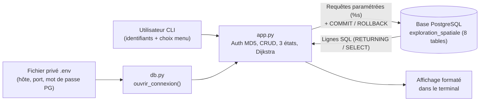

# À quoi sert la couche Python par rapport aux fichiers SQL ?

> Guide pédagogique pour comprendre le rôle concret des programmes Python ([`db.py`](../db.py), [`app.py`](../app.py), [`insertion_echantillon.py`](../insertion_echantillon.py), [`import_csv.py`](../import_csv.py)) face aux scripts SQL statiques, suivi d'un décryptage simple des syntaxes Python et PostgreSQL utilisées.

---

## 1. La problématique initiale : pourquoi les fichiers SQL ne suffisent pas ?

Les trois fichiers `.sql` sont parfaits pour **construire** et **interroger manuellement** la base de données, mais ils sont **statiques** : ils ne savent pas faire tourner une vraie application interactive.

| Besoin concret | Fichiers `.sql` seuls | Programme Python (`db.py` + `app.py`) |
| :--- | :--- | :--- |
| **Quand les lance-t-on ?** | À la main dans `psql` ou pgAdmin, au déploiement. | À tout moment via un menu interactif en ligne de commande. |
| **Origine des données** | Écrites en dur dans [`02_seed.sql`](../sql/02_seed.sql) (figées). | Saisies dynamiquement par l'utilisateur (ou lues depuis un CSV externe via [`import_csv.py`](../import_csv.py)). |
| **Sécurité des entrées** | Coller du texte saisi dans du SQL ouvre des failles (injection SQL ou erreur sur une apostrophe). | Utilise des **requêtes paramétrées (`%s`)** : sépare strictement la commande SQL des données. |
| **Secrets et collaboration GitHub** | Un `.sql` ne sait pas lire un fichier `.env` local. | Lit le fichier privé `.env` (ignoré par Git) pour ne jamais exposer de mot de passe PostgreSQL sur GitHub. |
| **Authentification et profils** | Ne sait pas gérer une session utilisateur ni bloquer un menu. | Vérifie `username` + `md5(%s)` côté PostgreSQL, puis autorise ou bloque l'écriture/suppression selon le profil (`observateur`, `scientifique`, `administrateur`). |
| **Algorithmes avancés** | Calculer un plus court chemin multi-critères est verbeux en SQL pur. | Charge le graphe `trajectoire_orbitale` depuis PostgreSQL et calcule le trajet optimal avec **Dijkstra** (`heapq`) en quelques lignes. |

### L'image simple pour retenir la différence

* **PostgreSQL + les fichiers `.sql`**, c'est une **bibliothèque avec ses étagères et son règlement** :
  * `01_schema.sql` construit les 8 étagères et les règles (*1 mission = au plus 1 échantillon*, *pas de boucle sur un même astre*, etc.).
  * `02_seed.sql` pose les données de départ (profils, comptes MD5, astres, trajectoires, missions, instruments, échantillons).
  * `03_queries.sql` rassemble les requêtes de référence (3 états + graphe + auth MD5).
* **Les programmes Python (`psycopg`)**, c'est le **logiciel d'accueil qui fait vivre la bibliothèque** :
  * [`db.py`](../db.py) ouvre la connexion sécurisée via `.env`.
  * [`app.py`](../app.py) authentifie l'utilisateur, propose un menu clair (insérer, modifier, supprimer avec vérification, afficher les 3 états, calculer un itinéraire Dijkstra).
  * [`insertion_echantillon.py`](../insertion_echantillon.py) fournit une petite démo isolée de l'UPSERT `1:1`.
  * [`import_csv.py`](../import_csv.py) permet, si besoin, d'importer un fichier CSV externe sans toucher au schéma.

---

## 2. Vue d'ensemble des échanges entre Python et PostgreSQL



---

## 3. Fonctionnement pas à pas des briques Python

### Brique A — Connexion sécurisée et encodage (`db.py`)
1. `configurer_sortie_utf8()` vérifie `isinstance(flux, io.TextIOWrapper)` puis force l'encodage UTF-8 pour afficher proprement les accents sous Windows.
2. `charger_config_db()` lit `.env` à côté du script (`Path(__file__).resolve().parent / ".env"`), vérifie que `PGPASSWORD` est défini, et retourne un objet typé `DbConfig`.
3. `ouvrir_connexion()` appelle `psycopg.connect(dbname=..., user=..., password=..., host=..., port=...)` avec des arguments nommés explicites (propre à l'exécution et validé sans erreur par Pylance).

### Brique B — Ouvrir connexion et curseur (`with ... as conn, conn.cursor() as cur:`)
* `conn` (*connection*) représente la ligne réseau ouverte vers PostgreSQL.
* `cur` (*cursor*) est l'objet qui envoie les ordres SQL (`cur.execute(...)`) et lit les résultats (`cur.fetchone()`, `cur.fetchall()`).
* Le bloc `with` garantit la fermeture automatique de la connexion même si une erreur survient.

### Brique C — Transactions (`commit()` et `rollback()`)
* Par défaut dans `psycopg`, toute écriture (`INSERT`, `UPDATE`, `DELETE`) se fait dans une **transaction temporaire**.
* `conn.commit()` valide définitivement l'opération en base.
* En cas d'erreur SQL (ex. contrainte `UNIQUE` ou `CHECK` violée), `except psycopg.Error:` appelle `conn.rollback()` pour annuler proprement la transaction et permettre à `app.py` de continuer sans planter.

---

## 4. Décryptage des syntaxes Python & SQL importantes

Cette section reprend les notions qui peuvent surprendre à la première lecture dans [`db.py`](../db.py), [`insertion_echantillon.py`](../insertion_echantillon.py) et [`app.py`](../app.py).

### 4.1. La flèche `-> None` et les annotations de type

```python
def configurer_sortie_utf8() -> None:
def charger_config_db() -> DbConfig:
```

* La flèche `->` placée avant `:` est une **annotation de type de retour** (*type hint*).
* Elle indique au lecteur et à l'IDE **ce que renvoie la fonction** avec `return`.
* `-> None` signifie simplement : *« cette fonction effectue une action mais ne renvoie aucune valeur (`None`) »*.
* Sur un dictionnaire, une notation comme `dict[str, str | int]` se lit : *« un dictionnaire dont les clés sont des textes (`str`) et les valeurs sont soit des textes (`str`), soit (`|`) des entiers (`int`) »*. Dans la version refactorisée de [`db.py`](../db.py), on utilise même une `@dataclass` nommée `DbConfig`, encore plus claire et validée sans avertissement par Pylance.

---

### 4.2. Construire le chemin vers `.env` avec `Path`

```python
env_path = Path(__file__).resolve().parent / ".env"
```

| Morceau | Rôle | Exemple concret (Windows) |
| :--- | :--- | :--- |
| `__file__` | Chemin du script Python en cours d'exécution. | `db.py` |
| `Path(__file__).resolve()` | Transforme en objet `Path` (`pathlib`) et résout le chemin absolu. | `C:\Users\...\devoirBDD\db.py` |
| `.parent` | Remonte d'un cran vers le **dossier parent**. | `C:\Users\...\devoirBDD` |
| `/ ".env"` | Avec `pathlib`, `/` **colle** le nom de fichier au dossier (ce n'est pas une division). | `C:\Users\...\devoirBDD\.env` |

---

### 4.3. Le dépaquetage `**dictionnaire` (et pourquoi `db.py` préfère des arguments nommés)

En Python, écrire `fonction(**dico)` « ouvre » le dictionnaire pour transformer chaque paire `clé: valeur` en argument nommé `clé=valeur` :

```python
# Avec un dictionnaire db_params = {"dbname": "exploration_spatiale", "port": 5432, ...}
psycopg.connect(**db_params)
# Équivaut strictement à :
psycopg.connect(dbname="exploration_spatiale", port=5432, ...)
```

Dans [`db.py`](../db.py), nous passons directement les arguments nommés depuis `DbConfig` (`dbname=cfg.dbname, ...`) pour que le vérificateur de types de l'IDE (Pylance) puisse vérifier chaque paramètre sans faux positif.

---

### 4.4. `ON CONFLICT ... DO UPDATE`, `EXCLUDED` et `RETURNING`

```sql
ON CONFLICT (id_mission) DO UPDATE
    SET code_tube = EXCLUDED.code_tube,
        type_roche = EXCLUDED.type_roche,
        masse_grammes = EXCLUDED.masse_grammes
RETURNING id_echantillon;
```

1. **`ON CONFLICT (id_mission) DO UPDATE` (UPSERT)** : si la mission ciblée possède déjà un échantillon (conflit avec la contrainte `1:1` `UNIQUE (id_mission)`), PostgreSQL met à jour la ligne existante au lieu de planter.
2. **`EXCLUDED`** : désigne la **nouvelle ligne candidate** que l'on vient d'envoyer et qui a déclenché le conflit (`SET code_tube = EXCLUDED.code_tube` remplace l'ancienne valeur par la nouvelle).
3. **`RETURNING id_echantillon;`** : demande à PostgreSQL de renvoyer immédiatement l'identifiant créé ou mis à jour, comme un mini `SELECT` intégré.

---

### 4.5. Récupérer 1 ligne avec `fetchone()` et `row_id[0]`

```python
row_id = cur.fetchone()
if row_id is None:
    raise RuntimeError("Aucun identifiant retourné après l'insertion.")
id_genere = row_id[0]
```

* `cur.fetchone()` lit **la seule ligne** renvoyée par `RETURNING`, sous forme de **tuple** à 1 case (ex. `(4,)`) ou `None`.
* `if row_id is None:` est un garde-fou évitant une erreur si rien n'est renvoyé.
* `row_id[0]` extrait le premier élément (les indices démarrent à `0` en Python), soit l'entier `4`.

---

### 4.6. Lire plusieurs lignes (`fetchall()`) et aligner l'affichage (`:<12`, `:>5`)

```python
rows = cur.fetchall()
for row in rows:
    print(
        f"ID #{row[0]:<2} | Code: {row[1]:<12} | Roche: {row[2]:<35} "
        f"| Masse: {row[3]:>5} g | Mission: {row[4]} ({row[5]})"
    )
```

* `cur.fetchall()` récupère **toutes les lignes** du `SELECT` dans une liste de tuples.
* `for row in rows:` parcourt chaque ligne ; `row[0]` à `row[5]` correspondent aux 6 colonnes du `SELECT` dans leur ordre exact.
* Les formats `:<12` et `:>5` dans une *f-string* servent uniquement à **aligner proprement les colonnes** dans le terminal :
  * `:<12` : largeur minimale de 12 caractères, aligné à **gauche** (`<`).
  * `:>5` : largeur minimale de 5 caractères, aligné à **droite** (`>`).
